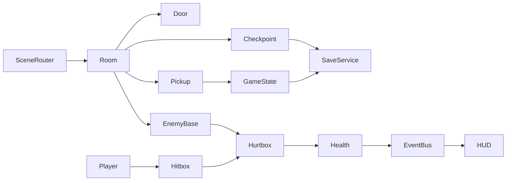

# 鲸落 Godot 重构：AI 友好的 2D 战斗探索架构

## 现有 Godot 工程能不能直接用

能玩，但不适合作为长期的开发基座：
- `first-level` 已经实现 5 房首关：短击和重鸣、负壳蟹 Boss、贴流冲、存档和地图，是目前最完整的成果。
- 但逻辑写死了房间序号（如 `if game.room_index==3`），玩家、相机和敌人都在代码里 `new()` 拼装。`main.gd` 混入了 9 种 `--qa-*` 测试驱动；存档是不带类型的 Dictionary；三个工程互相复制代码（同名的 `player.gd`、`level.gd` 有三份）。
- AI 每改一处都要读 500 到 1263 行的大文件，而且改动容易互相影响。

结论：旧工程原样保留，作为参考和素材来源；新工程按清晰的模块边界重建，再逐批迁移已验证的手感参数、房间数据和素材。

## 保留与提交范围
- **全部保留在原位**：`godot/` 三个工程（场景、脚本、`assets/`、`docs/`、`production-history/`）、根目录 `assets/`、`docs/鲸腹遗城原画集/`，以及 `mvp*/` 三个 Web 原型（冻结，不再开发；V2 的 Pages 地址继续可玩）。
- **取消跟踪，但文件仍留在本地，Git 历史里也找得到**（用 `git rm -r --cached`，不重写历史，不强推）：
  - `godot/*/.godot/`（约 600M 编辑器缓存）
  - `godot/*/evidence/`（约 1.2G 验收截图）
  - `godot/*/.production/`
  - `work/effekseer/1.80.7/`（工具二进制）
  - `work/whalefall-share/` 下的 `cloudflared.exe`、`*.log`、`*.pid`、`processes.json`、`known_hosts`
- 同步清理 `.gitattributes` 中指向这些文件的逐文件 LFS 规则；新工程改用按扩展名匹配的规则，例如 `game/**/*.png filter=lfs diff=lfs merge=lfs -text`。
- `.gitignore` 新增 `.godot/`、`*.import` 之外的构建输出 `game/build/`、`.tools/`（存放 Godot 本体和导出模板）、`*.log`、`*.pid`、`evidence/`。`.import` 文件需要提交，Godot 官方建议提交它们。

## 新工程结构（`game/`）

```
game/
  project.godot            # 4.7.2, GL Compatibility, autoload 注册
  AGENTS.md                # 工程内 AI 规则（短，链接 docs）
  src/
    core/      game_state.gd, save_service.gd, event_bus.gd, scene_router.gd
    player/    player.tscn, player.gd, player_tuning.tres, states/*.gd
    combat/    hitbox.gd, hurtbox.gd, health.gd, attack_data.gd
    enemies/   enemy_base.gd, corpse_crab/, shell_crab_boss/
    world/     room.gd, door.gd, checkpoint.gd, pickup.gd, ability_gate.gd
    ui/        hud.tscn, map.tscn, pause.tscn
  content/
    rooms/R1/R1-01.tscn ... R1-07.tscn   # 每房一个场景，数据随场景
    data/      abilities.tres, world_graph.tres, enemies/*.tres
  art/         # 从 assets/runtime 与 godot/first-level/assets/runtime 按清单复制的运行素材
  tests/       run_tests.gd + test_*.gd（无第三方依赖的 headless 运行器）
```



## 让 AI 容易接手的约定（写入 `docs/architecture.md` 和 `game/AGENTS.md`）
- 一个功能一个目录；单个脚本不超过约 250 行。全部使用带类型的 GDScript，用 `class_name` 命名，并把未声明类型的告警设为错误。
- 房间、能力、敌人的数值用 `.tres` Resource 或场景导出属性描述，统一用稳定 ID（如 `R1-04`、`ability.dash`），不按房间序号或显示名做判断。
- 模块之间通过 `EventBus` 信号和 `GameState` 通信，不跨节点直接调用 `main`。
- 测试驱动只放在 `tests/`，游戏代码里不出现 `qa_mode` 分支。
- 场景用 `.tscn` 文本手工编排，碰撞体与素材在场景里对齐；不在代码里 `new()` 拼装关卡。
- 统一入口 `node tools/godot.mjs <check|test|run|export-web>`（Node 已是现有依赖），Godot 路径从环境变量 `GODOT` 或 `.tools/` 读取，固定版本写在 `game/.godot-version`。

## 交付：Godot Web 导出到 GitHub Pages
- 使用单线程 Web 导出，GitHub Pages 不提供 COOP/COEP 响应头，不能用多线程版。
- 先发布到 `/BOB/godot/`，根地址继续是 V2。新版达到首关同等内容后，再把根地址切到 Godot 版。
- 新写 `tools/deploy-pages.mjs`：导出后合并到已有的 `gh-pages` 分支，正常推送，不强推；`mvp/deploy.mjs` 原样保留。

## 分批计划（每批都能独立试玩、提交并发布）
1. **仓库清理**：调整忽略规则和 LFS 规则，取消跟踪上文列出的文件。验证：核对 `git status` 只包含预期变更，且本地文件仍然存在。
2. **架构文档、骨架和工具**：编写 `docs/architecture.md`，搭建 `game/` 骨架、autoload、测试运行器和 `tools/godot.mjs`。验证：headless 下 `test` 通过。
3. **玩家与战斗**：迁移 `first-level/scripts/player.gd` 的移动、跳跃缓冲、短击连段、重鸣、受击、冲刺参数到 `player_tuning.tres`，并拆成状态脚本；同时实现 Hitbox/Hurtbox/Health。
4. **房间与世界连接**：把 `first-level/assets/rooms.json` 和 `scenes/r1/*.tscn` 迁成 `content/rooms/R1/` 场景，包括门、营地、跨房切换和断桥机关。
5. **敌人与 Boss**：实现尸蟹和负壳蟹 Boss（基于 `enemy.gd` 的行为），胜利后在 Boss 房取得冲刺能力。
6. **存档、HUD、地图、暂停**：存档带版本号，有备份恢复，不覆盖旧工程存档。
7. **Web 导出与 Pages 发布**：发布到 `/BOB/godot/` 并核实线上。
8. **文档与 Skill 同步**：更新 AGENTS.md、README；新增 `.agents/skills/godot-game-dev/SKILL.md`；把 Web 相关 Skill 标为仅用于旧原型。

## 测试 case
- 清理后 `git ls-files | rg "\.godot/|evidence/|\.exe$|\.pid$"` 结果为空，但本地这些文件仍然存在。
- 在 headless 下运行 `node tools/godot.mjs test`：覆盖存档读写、损坏文件回退到 `.bak`、能力门槛，以及 Hitbox 命中只扣一次血。
- 实机按键走完 R1-01 到 R1-05：打败 Boss，取得冲刺，越过冲刺沟，退出重进后从营地继续。
- 在 Web 导出的 `/BOB/godot/` 页面能加载素材和音频，且 V2 旧地址仍可玩。

## 实施记录（2026-10-28）

本计划的工程骨架、五房首关可玩迁移、七房场景/门配置、战斗与存档 UI、Web 发布和文档 Skill 已完成；详情和证据见 [game/progress.md](../../game/progress.md)。旧版本已按仓库迁移收入 `legacy/`，以当前架构文档为路径准据。

固定 Godot 4.7.2；`check` 通过、16 项测试通过，本地与线上五房真实键盘路线及刷新续档通过。线上源码 `3969521`，发布提交 `1fdb0f3`，Pages 部署成功。R1-06 / R1-07 保留后续浮升/挂环门槛，本计划不授予这些后续能力，不将场景迁移计作其可达路线验收完成。
