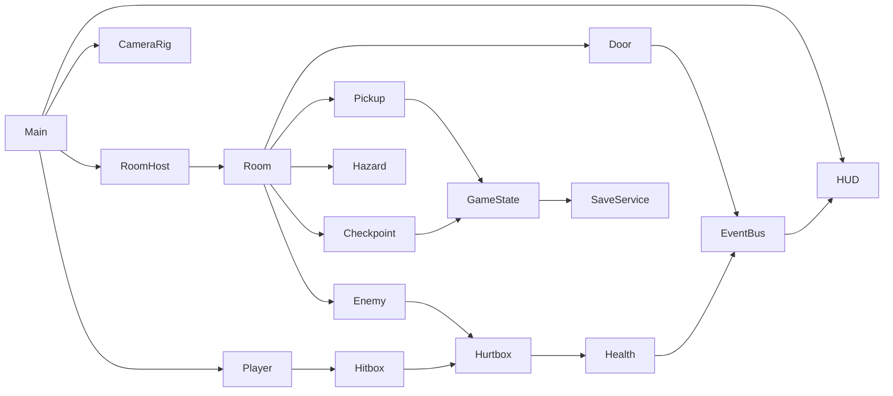

# 鲸落 Godot 架构

2D 战斗 + 收集探索（类空洞骑士）的正式工程位于 `game/`，固定 Godot 4.7.2、GL Compatibility 渲染、Web 单线程导出。本文是模块边界与约定的唯一主说明；工程内 AI 规则见 [game/AGENTS.md](../game/AGENTS.md)。

## 仓库分工

| 目录 | 角色 | 是否继续开发 |
| --- | --- | --- |
| `game/` | 正式 Godot 工程：代码、场景、运行素材、测试 | 是 |
| `assets/` | 全局素材库：制作源、导出、台账，`game/art/` 从这里按清单同步 | 是 |
| `docs/鲸腹遗城原画集/` | 世界观、关卡与原画设计 | 是 |
| `legacy/godot/` | 旧 Godot 工程，作为玩法与素材参考 | 冻结，只读 |
| `legacy/web/` | Web 原型（mvp、mvp-v2、mvp-nightmare） | 冻结，V2 线上地址保留 |

## 模块



| 路径 | 职责 |
| --- | --- |
| `src/core/` | `EventBus`（全局信号）、`GameState`（生命、蓄振、能力、标记、营地）、`SaveService`（存档读写与校验）。前两者是 autoload |
| `src/main/` | 主场景：加载存档、切换房间、放置玩家、死亡重生、暂停 |
| `src/player/` | 玩家场景、手感参数 `PlayerTuning`、攻击、动画 |
| `src/combat/` | `Hitbox`、`Hurtbox`、`Health`、`HitData`，玩家和敌人共用 |
| `src/enemies/` | `EnemyBase` 状态机，具体敌人只覆盖招式选择和数值 |
| `src/world/` | `Room`、`Interactable` 及门、营地、拾取、拉杆、危险区、Boss 场地、布景视差 |
| `src/ui/` | HUD、地图/暂停面板与中文 Theme（地图共用暂停场景） |
| `content/rooms/<区域>/<房间ID>.tscn` | 每个房间一个场景：布景、碰撞、入口点、玩法节点 |
| `content/data/` | 只读数据：能力表、世界地图（GDScript 常量，可直接加载和测试） |
| `art/` | 运行素材，由 `art/manifest.json` 从 `assets/` 或 `legacy/godot/` 同步缩放，不手工改 |
| `tests/` | 无第三方依赖的 headless 测试 |

## 约定

- **稳定 ID 驱动**：房间 `R1-04`、门 `E03`、能力 `ability.dash`、标记 `boss.r1_shell_crab`。逻辑只比较 ID，不按房间序号、显示名或素材判断。
- **数据随场景**：门的去向、需要的能力、拾取物给什么，都写在节点的 `@export` 属性上；新增房间不改代码。
- **房间结构**：根节点挂 `Room`，子节点固定为 `Scenery`（`Far`/`Middle`/`World`/`Foreground`，碰撞在 `World`）、`Entries`（`Marker2D`，名字就是入口 ID，如 `E01`、`camp`）和 `Gameplay`（门、营地、敌人等）。门的 `target_entry` 指向目标房间的入口名。
- **通信**：节点之间用 `EventBus` 信号或 `GameState` 方法交互，不持有 `main` 的引用。
- **持久状态只有一处**：`GameState` 保存能力、标记和营地房间；生命和蓄振属于运行状态，营地恢复满值。
- **物理层**：1 world，2 player，3 enemy，4 player_hurtbox，5 enemy_hurtbox，6 interactable，7 hazard。
- **代码规模**：一个功能一个目录；单个脚本尽量不超过 250 行（`check` 会提示）；全部使用带类型的 GDScript 和 `class_name`。
- **测试与游戏分离**：游戏代码里没有 QA 分支；测试在 `tests/` 里直接实例化场景并驱动。
- **浏览器可观察性**：`src/core/web_status.gd` 提供只读 `render_game_to_text()`；不接受状态写入、传送或伤害命令。浏览器驱动在 `tests/web_playthrough.mjs`，通过真实键盘操作。
- **正式美术**：遵循 [AGENTS.md 的 2D 素材规则](../AGENTS.md#正式美术必须使用2d素材)。缺图时先补素材，再在 `art/manifest.json` 登记同步。

## 存档

`user://save.json`，独立用户目录 `WhalefallGame`，不读写旧工程存档。格式：

```json
{ "version": 1, "checkpoint_room": "R1-01", "abilities": ["ability.dash"], "flags": ["boss.r1_shell_crab"] }
```

先校验并写 `.tmp`，再把有效旧档备份为 `.bak`，最后改名替换。损坏的主档不能覆盖有效备份；读档时校验失败就读 `.bak`，两份都失败则开新档。校验包括已注册房间 ID 和字符串能力/标记数组。改格式时提升 `version` 并在 `SaveService.migrate()` 中迁移。

测试仅使用 `test-save.json`，手动预览使用 `manual-preview.json` 且关闭自动写入。Web 测试采用独立浏览器上下文；与 V2 的 LocalStorage 键分别存储。

## 命令

需要 Node.js 18+ 和 Godot 4.7.2。脚本按以下顺序找 Godot：环境变量 `GODOT`、`.tools/godot/`、`D:/Godot_v4.7.2-stable_win64.exe/`。

```sh
node tools/godot.mjs check       # 导入资源、解析全部脚本、检查脚本行数
node tools/godot.mjs test        # headless 运行 tests/
node tools/godot.mjs run         # 打开游戏窗口
node tools/godot.mjs editor      # 打开编辑器
node tools/godot.mjs sync-art    # 按 art/manifest.json 同步并缩放运行素材
node tools/godot.mjs export-web  # 导出到 game/build/web
node game/tests/serve_web.mjs    # 带 /BOB/godot/ 前缀的独立验收服务
node game/tests/web_playthrough.mjs # Node 20+、Playwright，真实按键五房 + 地图/暂停 + 续档
node tools/deploy-pages.mjs      # 导出并发布到 gh-pages 的 /godot/
```

Godot 命令会校验引擎版本，并把日志里的脚本错误和 `ERROR:` 视为失败。Web 导出关闭线程与扩展，排除测试和工具源码；需要安装匹配版本的单线程 Web 模板。发布脚本更新现有 Pages 检出的 `godot/` 和根 `index.html`（来源 `game/pages/index.html`），默认跳转到 Godot，保留历史版本目录并正常推送；`--entry-only` 只更新根入口，沿用线上游戏包。`build.json` 记录游戏包源码提交，线上复核另见 [进度](../game/progress.md)。

## 从旧工程迁移的内容

| 旧位置 | 新位置 |
| --- | --- |
| `legacy/godot/first-level/scripts/player.gd` 中的数值 | `game/src/player/player_tuning.tres` |
| `legacy/godot/first-level/scripts/enemy.gd` 行为 | `game/src/enemies/` |
| `legacy/godot/first-level/scenes/r1/*.tscn` 布景与碰撞 | `game/content/rooms/R1/*.tscn` 的 `Scenery` |
| `legacy/godot/first-level/assets/rooms.json` 中的门、敌人、危险区和奖励 | 各房间场景的 `Entries` 与 `Gameplay` 节点 |
| `legacy/godot/first-level/assets/runtime/` 中的英雄帧、敌人、布景和音效 | `game/art/`（通过清单同步） |
