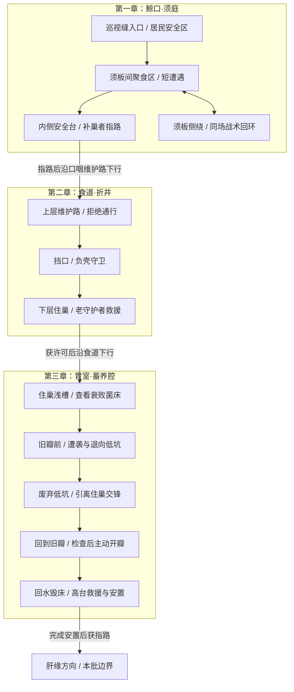

# 新主线前三章 · 关卡拆解与制作清单

2026-11-04 · 设计批次 01。依据用户确认的世界观数据库方向推进，核对源码基线 `c1a73b99`。本批完成设计和复用盘点；下文房间、事件、素材制作与验收均为待实施方案，不是当前试玩内容。

## 依据与范围

- [世界观与人物设定 v0.1](../世界观与人物设定初稿.md)：拾潮者循歌进入；守护者有真实救城功绩；主角逐渐理解并承担改变的代价。
- [主线叙事 v0.2](../主线叙事初稿.md)：前三章为须庭、折井、蓄养腔；具体场景事件和战斗收束以各章原文为依据。
- [数据库地图说明](../world-archive.md)：十二节点表达故事顺序，尚未对应游戏房间。用户已确认以此为制作方向，具体对白、外形和关卡参数仍需制作。
- [当前工程架构](../architecture.md)、[母蟹接入](../mother-crab-integration.md)与[场景制作源](../../assets/source/r1-chapter-scenes/README.md)：用于判断现有能力、资源和历史验证边界。

本批先把前三章拆成三个主要房间场景，每章一个腔室、内部多个区段。场景文件数量可在性能与镜头验证后调整，不把一章限定成一个屏幕。支路先承担观察和战术绕行，不新增奖励、族群、支线或技能授予。

第一章是下一制作批次的完整样板。第二、三章本批交付可执行设计与缺项清单，暂不生产其整套资源。下文新增的区段、检查点、事件键和状态存储均为关卡实现提案，不回写成原稿已经确定的世界规则。

## 1. 三章空间草图

箭头表示推进顺序；事件完成后的安全路段可原路返回，不表示必须使用单向传送。区段名是工作标记，不增加新的正式地点。两章交界保留来路、目标地标与材质过渡，不能因换场景把高度或器官位置突变当作连续空间。

| 腔室与拟定房间 ID | 主路径与可探索部分 | 门槛、检查点及回返 |
| --- | --- | --- |
| 须庭 `story-c01-xuting` | 外海巡视缝→补巢者所在安全区→须板聚食通道→内侧出口；须板左右形成短回环，回望口侧浑水。补巢者可沿居民维护侧道到内侧台，NPC换位须有离镜或可见行走依据。维护侧道仅供居民穿行，用真实狭窄结构说明，不能成为玩家绕过必经遭遇的捷径。 | 基础移动、跳跃、短击可完成；遭遇前安全台作样板恢复点。通行条件是威胁退却并完成指路；不依赖冲刺、浮游或牵引。 |
| 折井 `story-c02-zhejing` | 上层支架路→封锁挡口→下层住巢；战场留出绕壳换位空间，旁台用于观察坍塌与救援。 | 拒绝通行后交战，解除阻拦后停止敌对；救援结束、获许可才进入蓄养腔。战前恢复点不与Boss判定重叠；不设绕过主要事件的出口。 |
| 蓄养腔 `story-c03-xuyang` | 住巢浅槽→回水与旧瓣→撤向废弃低坑交锋→回瓣检查和操作→高台安置。低坑是战术侧路，不另加支线任务。 | 战斗胜利只解除阀前危险；开瓣需另一次主动输入；安置完成后通往肝缘。事故后的恢复点位于高台，原路回访仍看到损失。 |

恢复点优先使用已有营地表现与恢复能力；具体摆位需在新图中补齐2D支撑和可达性。前三章不先套用旧七房的能力门槛。精确长宽、跳距和敌人数量在第一章试摆与真实输入后记录，不从概念图估算成已测量数值。

## 2. 玩家流程与事件合同

### 第一章：认识活着的遗城，再穿过聚食区

1. 从巡视缝进入，看见补巢者修补住巢，主动共鸣。保留“等一轮巡视”的含义，居民位于交战区之外。
2. 低鸣指向须板通道；声音有简短文字提示，静音也能理解方向。玩家继续向内才触发遭遇，不在对话期间突然受击。
3. 食腐甲先单只近扑，再形成侧面压力；须板提供真实可用的绕行和分隔。战斗动画、攻击预告与命中一致。
4. 达成击退条件后，敌人实际退回聚食范围并停止追击；短击结算在此转入退却，不套用死亡掉落。双方脱离后内侧通路安全。
5. 在内侧台与补巢者交流，获知折井方向；回水在滤缝边绕圈退回，留下未解释的环境线索。玩家主动抵达出口后结束样板。

出口开放条件：必要交锋已发生、两侧威胁已退回且不再追击、指路已完成。第一章完成还需玩家主动进入已开放出口，不能在对话结束时直接弹完成界面。敌人卡住、消失、全部死亡或玩家跳过交锋，都不能自动记为完成。

### 第二章：战胜阻拦，再见证守护者救人

1. 守卫明确拒绝通行，重壳封路后升级为交战；战斗围绕壳缘压位、扣带和转身空隙展开。
2. 胜利使负壳守卫失去阻拦能力，保留其存活及可见身体，停止攻击和碰撞封路。
3. 进入安全见证区后发生下层坍塌；老守护者撑梁、救出居民。此段独立于战斗结算，不增加第二波敌人或强制护送战。
4. 救援后交流，取得沿主路前行的许可；负壳守卫留在后方修补挡口。

现有母蟹的攻击/受击适配可供研究，但其三招和300生命值不自动成为本章定稿。原稿的扣带破绽、存活状态、救援表演均需新做；本章不自动授予冲刺。

### 第三章：让开瓣成为玩家执行的判断，让损失留下来

1. 与补巢者重逢，观察发灰菌床、回流污絮及封闭旧瓣；原稿中的局部观察尚不足以判断整条回水通路。
2. 栖污大甲袭击后，玩家退向废弃低坑交锋，居民留在安全区。大甲缩回低坑后结束威胁。
3. 恢复自由操作，玩家另行检查眼前流向，再明确执行“撬开旧瓣”。战斗胜利不自动触发开瓣；可以暂缓操作继续观察，但本批不承诺替代结局分支。
4. 回水冲毁菌床和住巢系带；这是主角判断的后果，不设置为注定失败的限时护巢挑战，也不提示“系统已确认安全”。
5. 老守护者从上层维护道赶来，与拾潮者一起固定巢片、将居民转移到高台。救援后追问主角是否查过回水去向，暂时保留通行许可，并要求承担安置；不能省略这段功绩与责任的承接。
6. 玩家完成余下固定巢片、绑稳系带的简短安置交互，不新增找材料任务。补巢者未接受道歉，安置结束后指向脂库。

旧瓣、菌床和巢片按状态切换真实2D素材。安置完成仍保留损坏痕迹，不在本章提前表现菌床完全恢复。

### 状态、死亡与重入（待实现）

采用独立章节进度，与旧七房V6隔离。下列键是本方案拟定的稳定 ID，尚未写入引擎；不使用显示名、原稿 `Nxx` 讨论编号或旧 `R1-04:0` 代替剧情状态。

| 事件键 | 前提及完成时机 | 重入与中断恢复 |
| --- | --- | --- |
| `c01.met_mender` | 首次共鸣完成 | 不重复强制介绍；仍可主动交流。 |
| `c01.foragers_retreated` | 交锋后敌人到达聚食范围、停止追击 | 保留非敌对聚食状态；指路未完成时继续去内侧台。未完成遭遇死亡则重置本场交锋。 |
| `c01.route_known` | 战后指路完成 | 出口开放；重进不再封路或重复结算。 |
| `c02.guard_yielded` | 守卫战败并解除敌对 | 永久保持存活非敌对；救援未完成则保留待触发状态。 |
| `c02.rescue_complete` / `c02.passage_granted` | 居民安全后、许可交流后分别提交 | 已完成救援不再坠落；已救援未交流时仅继续交流。救援中断则从该事件安全起点恢复。 |
| `c03.threat_retreated` | 大甲回到低坑并停止攻击 | 重入不重复出敌；旧瓣仍待主动检查和操作。 |
| `c03.valve_opened` | 玩家明确操作被接受时提交 | 同一事务记入“事故已触发”的持久阶段；中断后用事故后的素材与高台位置恢复，不重复开瓣或恢复完整菌床。 |
| `c03.guardian_aid_complete` | 老守护者到场、共同救援及责任交流完成 | 从未完成的安全事件段继续；安全落位不等于居民已全获救，不跳过到场、救援或追问。 |
| `c03.resettled` | 原稿安置动作全部完成 | 安置步骤需分别保存；完成后通向脂库，保留损坏和关系后果，不重复索取道歉。 |

事件按显式前置链推进：`met_mender → foragers_retreated → route_known`；`guard_yielded → rescue_complete → passage_granted`；`threat_retreated → valve_opened → guardian_aid_complete → resettled`。第三章的检查旧瓣也是接受开瓣操作的前提，不能任意写入独立标记绕过必经事件。

存档写入需原子化；事件事实与世界状态一起保存或由同一持久阶段推导。临时攻击、敌人路径、过场时钟不作为已完成事件。写入失败需可见提示并可重试，不谎报保存成功或触发不可恢复的重复结算。新游戏、死亡、刷新、返回房间及旧档字段缺失均需覆盖；基础世界观中的“共鸣残像”仍未展开，本方案只定义运行恢复行为。

## 3. 当前运行能力的复用清单

“可复用”表示当前源码存在相应能力，仍需在新章接入验收。本批仅检查源码和已有记录，未重跑游戏测试。

| 项目 | 现有依据 | 本批判断与实施要求 |
| --- | --- | --- |
| 角色移动、跳跃、近战、受击和逐帧表现 | [tide_player.gd](../../game/src/campaign/tide_player.gd)、[campaign_player.gd](../../game/src/campaign/campaign_player.gd)、[action_visual.gd](../../game/src/campaign/action_visual.gd) | 复用现有控制器与素材；隔离样板配置初始能力，不更改稳定版参数。先验证基础动作足以通过。 |
| 普通敌人接近、预告、攻击、恢复、命中代理 | [main.gd](../../game/src/campaign/main.gd) 的 `update_enemies`、[campaign_enemy_proxy.gd](../../game/src/campaign/campaign_enemy_proxy.gd) | 需适配：增加聚食范围、遭遇边界、退却路径和非致死结算；目前离开探测范围只是停下，非返回。静态贴图位移不算正式敌人动作。 |
| 母蟹攻击、护壳、反制与受击 | [boss/](../../game/src/campaign/boss/)、[现有接入说明](../mother-crab-integration.md) | 仅行为/接口候选；现有死亡、淡出、冲刺奖励与新章要求不同。不能因UI叫“负壳守卫”就认定角色剧情已完成。 |
| NPC共鸣、分阶段交流、事件承接 | [main.gd](../../game/src/campaign/main.gd) 的 `interact`；[ui_pages.gd](../../game/src/ui/ui_pages.gd) | 缺失。现有交互只有拾取、营地、门，现有UI无对话页。第一章只补必要交互和一次性事件，不先造通用任务编辑器。 |
| 门、营地、死亡与镜头 | [main.gd](../../game/src/campaign/main.gd)、[campaign_camera.gd](../../game/src/campaign/campaign_camera.gd) | 基础可复用，需移除新章对房间数组序号与第4房Boss特判的依赖，用独立房间/出口ID配置。营地和出口不要重叠。 |
| 保存校验、原子写盘和备份 | [ui_save_access.gd](../../game/src/ui/ui_save_access.gd)、[campaign_save_bridge.gd](../../game/src/campaign/campaign_save_bridge.gd) | 复用可靠写盘方式；新增章节状态及独立路径。当前V6没有上述事件字段。兼容 `GameState.flags` 属旧V1系统，不能直接当新章存档接入。 |
| 标题、HUD、地图、暂停、中文 | [src/ui/](../../game/src/ui/) | 可复用框架；标题与地图数据需适配新房间。对话关闭后清输入缓冲、还原焦点；新增汉字须扩字体子集。 |
| 水声与动作音效 | [environment.gd](../../game/src/campaign/environment.gd)、[main.gd](../../game/src/campaign/main.gd) | 播放机制可复用；章节鲸歌、共鸣反馈与事件声音尚缺专用接入，不能把背景水声当鲸歌。 |

**七房对应关系：** 当前仍是外伤坡→须筛→舌台→负壳蟹→流膜育窝，须筛另通喷气孔上层与鲸须记忆袋，详见 [rooms.json](../../game/art/whalebelly/rooms.json)。它们属于旧首关，可提供构件和经验，不能顺次改名为新前三章。新房间路径拟放 `game/content/story/`，小型事件与场景适配拟放 `game/src/story/`；只有实际实施时才创建文件、注册资源和更新架构。

根README的 `/godot-chapters/` 在本次追踪源码中未找到对应章节玩法实现，标为“历史线上入口，源码与完成度待核验”。`environment/chapter/` 是旧六房环境，不是十二章系统。未来先确定章节入口、存档隔离和发布目标，再写部署配置；不能直接覆盖未核验的历史入口。

## 4. 美术、动态与音频制作清单

遵循[全局美术规范](../../assets/art-style.md)。候选资产有真实PNG不等于符合新角色身份；源图、运行导出、动作状态与场景接入分别登记。

| 需要 | 现有来源/候选 | 待补齐与接入边界 |
| --- | --- | --- |
| 须庭远中近景、道路、支撑 | [首房分层源](../../assets/source/xumen-reference-environment/README.md)、[桥下修补](../../assets/source/xumen-underbridge-repair/README.md)、[须筛与六房源](../../assets/source/r1-chapter-scenes/README.md) | 可复用材质与合格原件；新聚落、通路绕行和跨镜头补底需补绘。首房是固定构图，不能拉长成多屏。 |
| 鱼、垂须、气泡、柔光 | [鱼群](../../assets/source/fish-schools-v01/README.md)、[垂须](../../assets/source/baleen-loop-v3/README.md)、[气泡分层源](../../assets/source/xumen-motion-elements/README.md)、[柔光](../../assets/source/xumen-soft-light/README.md) | 已有位图及运行方法；迁移后重新核对根点、边缘余量、遮挡和暂停，不照搬数量/FPS/摆幅。 |
| 食腐甲 | [嗅脂甲静态候选](../../assets/runtime/sprites/fat-sniffer/idle.png) | 未找到同身份完整资产。先做符合原稿的剪影样板，再制作聚食/移动/警觉/近扑/受击/退却动作；不可将现有静态图位移当动作交付。 |
| 补巢者与须庭居民 | [余索](../../assets/runtime/sprites/yusuo/base.png)、[贝驮](../../assets/runtime/sprites/beituo/base.png)仅旧角色参考 | 需新角色造型与持灯、补巢、交流、移动姿态；旧角色不直接改名。居民展示数量依镜头最低需求确定，不扩写族群设定。 |
| 须板战术分隔、聚食点、住巢与滤缝 | [悬根候选](../../assets/runtime/sprites/r1-hanging-root/base.png)、[住巢候选](../../assets/runtime/sprites/habitat-shell-nest/base.png) | 场景中须板须有固定、可读的阻隔结构；背景装饰不可冒充碰撞。食物、滤缝和浑水回流需要独立表现素材与层级。 |
| 折井、守卫存活与老守护者救援 | [旧守卫单图](../../assets/runtime/sprites/gate-shell-crab/base.png)、[母蟹V3](../../assets/source/crab-video-v3/README.md)、[V4](../../assets/source/crab-video-v4/README.md) | 需折井支架/扣带、失去阻拦但存活的状态、修补姿态；老守护者造型及撑梁救人动作缺项，不能直接复用母蟹死亡淡出。 |
| 蓄养腔菌床、水瓣与巢片 | [菌床](../../assets/runtime/sprites/habitat-fungus-bed/base.png)、[瓣叶](../../assets/runtime/sprites/nursery-valve-leaf/base.png)、[支撑](../../assets/runtime/sprites/nursery-shell-support/base.png)、[旧巢前](../../assets/runtime/sprites/r3-shell-nest-before/base.png)、[旧巢后](../../assets/runtime/sprites/r3-shell-nest-after/base.png) | 均为构件候选；尚缺本故事对应的受损菌床、撬瓣、回水毁床及高台安置状态组，老守护者到场及协助固定/救援动作也需覆盖。旧迁居前后图不能直接当事故状态。 |
| 鲸歌、共鸣与事件音效 | 现有环境水声和角色动作声 | 第一章先补循歌短句与交流反馈，记录来源/版权/循环/音量；第二、三章再补壳拖地、支架坍塌、阀瓣与回水。静音时保留必要视觉信息。 |

本轮抽查16件静态候选、三组鱼图集、垂须图集、气泡、六房 Far/Middle 共12张和母蟹九张图，合计42份PNG实体，均非LFS指针；该检查不证明新章引擎加载、动画、碰撞或用户审美已通过。没有生成新素材，也未把候选改记为正式在用。

### 第一章静动判断（制作前扫描）

| 元素 | 分类与理由 | 制作/复用方法与验收 |
| --- | --- | --- |
| 道路、骨架、住巢支撑、须板固定结构 | static：承担可读地形与空间分隔 | 位图静置，轮廓对齐碰撞；跟随镜头检查桥下、屏幕边缘和前景遮挡。 |
| 须板软梢、垂须与藻丝 | motion：固定端下的柔性运动 | 复用干净图集或根线约束网格；硬支撑保持固定；逐件检查根不漂、末端不过碰撞边界。 |
| 鱼群、气泡 | motion：游动与生命周期 | 自身动画与路径分开；气泡预热、限额回收；从静态层删除同物烘焙副本。 |
| 灯与水光 | motion：小范围亮度/材质变化 | 固定主光方向，水域蒙版限制范围；不让地形随水纹摇动。 |
| 食腐甲、补巢者、居民 | motion：行为和叙事表达 | 用逐帧角色动作；循环、位移、朝向及事件时机分别验收。 |
| 滤缝浑水回旋 | inspect：旧资产是否能明确表达“回流”尚未证明 | 先做一个局部样板；若现有位图不足先补绘。不能把普通上升气泡算作完成该线索。 |

既有成功方法以[六房制作](../../assets/source/r1-chapter-scenes/README.md)和各动件制作源为准：先静态还原、清重复像素、补暴露背景，再做单件运动与全景接入；每个像素只有一个绘制来源。新镜头须分别验证跟随视角与全景，单房截图不能代替连续路线。

项目[场景Skill路由](../../.agents/skills/scene-environment-motion/SKILL.md)的个人主源仍指向旧机器路径；本机相关技能目录未找到完整通用主源。本批仅引用已存在的项目制作证据，不声称加载了完整通用配方。启动新素材生产前先恢复或定位主源，缺失情况不得隐去。

旧[连续世界原画](../../assets/source/world-continuity-v1/README.md)基于V5.2的36房39边。共享地标、材质过渡可作参考，但其连接带尚未实机验证，旧路线、距离与能力门不移植成新十二章事实。

## 5. 第一章样板的执行批次

| 顺序 | 运行能力 | 创作交付 | 接入与结束条件 |
| --- | --- | --- | --- |
| A：场景与单件样板 | 独立章节入口/QA存档；复用原角色，不载入真实V6 | 须庭局部布局、食腐甲动作样板、补巢者造型与交流姿态、最短共鸣文本 | 用真实角色在居民安全区与须板通道试摆；补齐位图支撑，确认移动/换位可行。技术样板明确标记，尚不算完整第一章。 |
| B：完整第一章 | 共鸣交互、遭遇触发、非致死退却、出口条件和阶段保存 | 按A结果补齐动作、场景层、滤缝线索、鲸歌与共鸣反馈 | 从入口以真实按键完成指路与出口；恢复、重入及失败路径通过。样板出口到明确的“第一章完成”界面，不伪造未实现的折井。 |
| C：验证与发布 | 资源审计、Godot检查/测试、隔离Web导出 | 检查真实缩放、遮挡、声音与动作，记录用户美术认可状态 | 提交已验证源码，使用现有发布脚本落实独立发布目标并保留稳定入口；核对部署、版本及线上同一路线。写入progress后再推进第二章。 |

场景脚本只承担本章需要的状态和交互；实现时保持小函数、稳定ID和导出配置。通用能力优先复用现有组件，避免为了三个章节重写战斗、地图、任务编辑器或全存档系统。新资源按 `assets/` 制作源→台账→`game/art/manifest.json`→同步的现有流程交付。

第一章放行前必须具备：新章身份一致的补巢者与食腐甲、完整退却动作、可读安全区与战术通道、最小共鸣交流、循歌提示、保存/恢复及明确出口。任一缺项都记录为待完成，不用程序图形或提示文字冒充其正式美术。

## 6. 验证清单与本批结论

以下5组为实施后的测试用例，**本批均未执行游戏验收**：

1. **新档连续路线**：独立新档，普通键盘从巡视缝完成交流→遭遇→退却→指路→出口；不注入位置/伤害/能力，静音也能理解方向。
2. **战斗与居民边界**：须板确实分隔两侧威胁；居民不入战；食腐甲退回可见聚食区、停止追击；逃出探测范围或跳过敌人不会误判完成。
3. **恢复与存档隔离**：遭遇中死亡、退却后未指路刷新、指路后重入分别恢复正确阶段；不会改写正式V6或重复结算；损坏新章存档走明确恢复流程，写入失败可提示和重试。
4. **画面与操作**：实际位图加载，跟随/全景镜头下角色接地、平台支撑、须根和透明边缘正确；对话暂停与关闭后输入恢复、无遗留攻击；中文、环境暂停和声音正常。
5. **后续两章合同**：第二章守卫存活、救援只完成一次且不发冲刺；第三章战斗不自动开瓣，主动操作后损坏持久，安置中断可继续。仅在相应章实施后执行，不列入第一章已完成指标。

本批已完成：原稿因果核对、当前源码/素材引用盘点、PNG实体抽查、文档链接与差异检查。具体复核结果及提交见[工程进度](../../game/progress.md)。游戏代码、原稿正文与资源未改变，因此本批不运行引擎回归、不部署Pages；既有线上版本保持其原有完成度。
