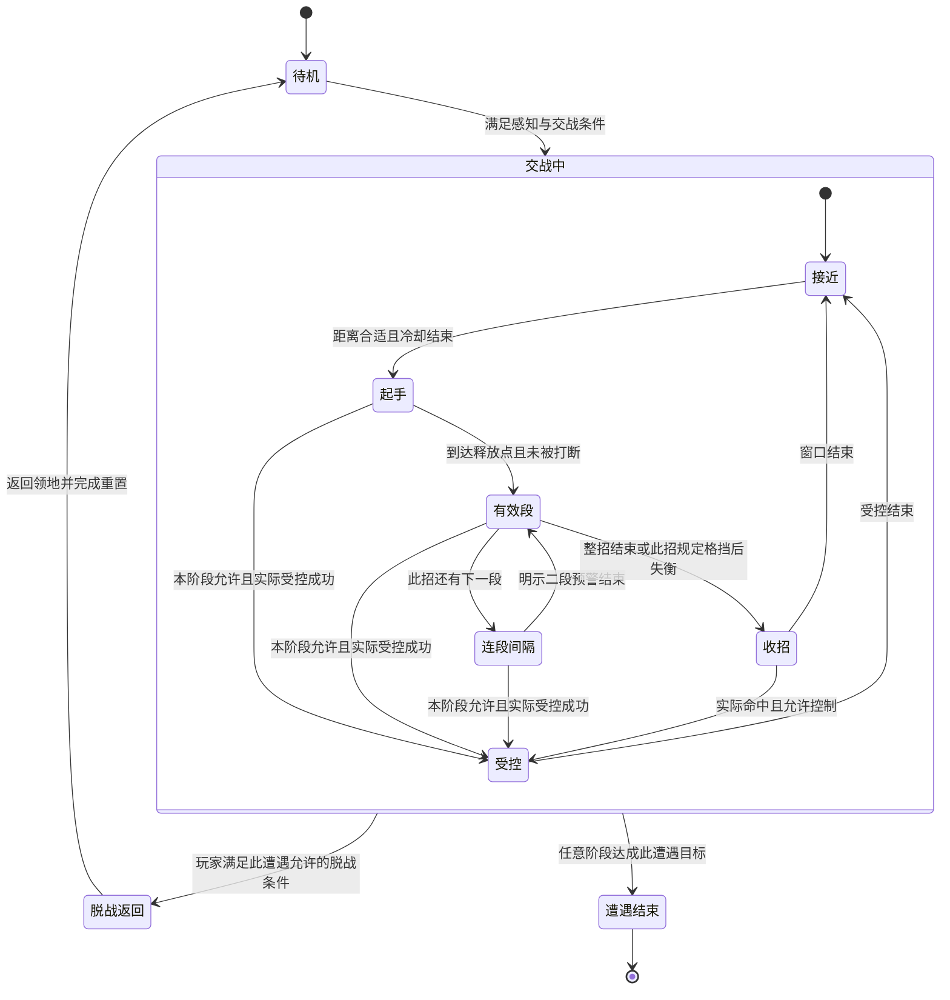

# 敌人设计与白盒验证

2026-11-19，v0.2。用户已确认当前第一章体验方向，接下来先覆盖全体敌人设计，再分批白盒验证。本稿依据[主线叙事初稿](主线叙事初稿.md)与[世界观与人物设定初稿](世界观与人物设定初稿.md)，不改写人物结局，不表示以下招式已实现。

当前最需要验证的不是敌人数量，而是：**换一种敌人之后，玩家是否必须改变判断和出招节奏。** 第一章已有的格挡、后跳、预输入与连招继续作为玩家基线；本轮不为敌人设计新增玩家技能，也不引入刷装循环。

当前增量状态：8类对象均已有独立敌人试验场入口，当前实现见文末各ED增量及试验场README；本稿设计表不代表全部章节、正式动画、关卡机关和叙事演出已接入。

## 1. 全敌人清单与来源

当前叙事提案包含8类交战对象、10处遭遇。第四、九章复用食腐甲，不计为新物种；第十、十一章不新增必经战斗。ED编号仅为本设计文档的引用编号，不是现有存档键或运行时ID。

| 设计编号 | 交战对象 | 章节与原稿位置 | 独特职责 | 交战结束与后续 |
| --- | --- | --- | --- | --- |
| ED-01 | 食腐甲 | 一/N01-01；四/N04-01可选；九/N09-01 | 护食追击、侧面挤压，教会短反击和分隔敌人 | 一章取得通路并退回食物；四章取得观察位或绕过；九章清开搬运索路，居民随后自行搬巢 |
| ED-02 | 负壳守卫 | 二/N02-01 | 重壳占位，逼玩家离开正面、利用慢转身 | 解除封锁，守卫存活；停止敌对，再接老守护者救援与许可 |
| ED-03 | 栖污大甲 | 三/N03-01 | 大体积逼近，促使玩家把交锋从窄处带到宽处 | 退入低坑、解除阀前危险；另行交互开瓣，事故不是战斗失败 |
| ED-04 | 缠巢鳗 | 五/N05-01 | 长身体的头尾双端威胁，追击时也要顾及退路 | 鳗死亡，停止战斗后居民决定去留；不把幼体作为必败护送目标 |
| ED-05 | 膜上捕食者（暂称） | 六/N06-01可选 | 从高处或侧上方扑入，考验短暂追击与暴露位置 | 清开暴露观察位或撤回遮蔽位脱战；具体死亡/逃逸表现待定，不影响关键证据 |
| ED-06 | 泵庭执卫 | 七/N07-01 | 长柄连续压位，考验防守中向出口撤离 | 玩家保住原件并到达窄道，老守护者喝止；执卫存活，不要求先打掉血条 |
| ED-07 | 封梁卫 | 八/N08-01 | 退步仍封入口、反制追击，考验逼动敌人站位 | 正常交战击败且战死；接无回应、取名壳、接巢，不做临时生死选择 |
| ED-08 | 老守护者 | 十二/N12-01 | 长柄控距与支柱站位结合，要求选择接近路线与连招长度 | 解除武装、失去拦闸能力，存活；随后救人和共同稳闸，不追加第二场Boss |

### 已有实现与新设计的边界

| 当前内容 | 本轮可复用什么 | 不能据此宣称什么 |
| --- | --- | --- |
| 第一章聚食怪样板 | 低扫/冲撞/二连、锁向、格挡破绽、压退与命中反馈 | 不等于食腐甲专属形象和全部遭遇编排已完成 |
| 普通尸蟹 | 物理、图集播放、伤害与浮空/击退接口 | 一招低扫不能直接充当8类敌人的行为 |
| 主线母蟹Boss | 横扫/下砸/冲撞、护壳/破防、阶段与角落检查的经验 | 当前R1-04:0死亡、奖励、存档不等于第二章“负壳守卫存活” |
| 套件敌人：群体、鸣贝、覆膜 | 群体移动、弹体与地面预警的现有运行能力 | 这些不是本稿8类叙事敌人的自动新增成员 |
| 第一章设计中的“窄口大甲” | 可作为食腐甲精英遭遇的候选变体 | 尚非叙事稿新增人物，不与第三章栖污大甲混为一只 |

实现核对入口：`game/src/narrative/chapter_one/forager.gd:104`为聚食怪阶段推进、`game/src/narrative/chapter_one/forager.gd:137`为反击加压、`game/src/narrative/chapter_one/forager.gd:176`为格挡反应；`game/src/campaign/enemies/corpse_crab.gd:215`起为浮空/倒地/压制接口；`game/src/campaign/boss/crab_moves.gd:18`为现有母蟹招式表，`game/src/campaign/boss/crab_shell.gd:15`为护壳结算，`game/src/campaign/boss/crab_boss.gd:207`为击败路径；`game/src/campaign/enemies/kit_encounter.gd:22`起为套件敌人构造。本轮只读核对，未修改这些实现。

## 2. 玩家应对职责矩阵

“主”表示该动作能形成此敌人的主要解法；“辅”表示可用但不能独自解决其完整压力。没有任何一行以固定技能键序为唯一解。

| 敌人 | 后跳撤招 | 格挡 | 跳跃 | 侧向换位/拉开 | 主动打断/控制 | 玩家需要改变的习惯 |
| --- | --- | --- | --- | --- | --- | --- |
| 食腐甲 | 主：从近身追击撤出 | 主：成功后可短反击 | 主：越过低扫 | 主：把两只分在同侧 | 主：普通轻体可控 | 第一只扑空后仍检查第二只的位置 |
| 负壳守卫 | 辅：避近钳，壳推可能仍追到 | 辅：挡住钳击，不自动卸壳 | 辅：越低钳，不能凭空穿过壳体 | 主：引其前压后越侧，抓转身 | 辅：只在暴露阶段起效 | 不把整套连招打在壳的正面 |
| 栖污大甲 | 辅：争取引怪距离 | 辅：挡单击，不能消除体积压迫 | 辅：越低扫，落点仍要安全 | 主：退向宽处，再回腹侧 | 辅：抬甲窗口可打断 | 不在住巢窄槽里原地换血 |
| 缠巢鳗 | 主：撤出扑咬 | 辅：挡住头部一次攻击，不忽略尾部 | 辅：越低扫尾，需确认头部位置 | 主：从头尾攻击间切入安全侧 | 辅：暴露时可压制头部 | 追头部时同时观察尾巴与退路 |
| 膜上捕食者 | 辅：避扑击落点 | 辅：朝来袭方向挡扑击 | 辅：短追击，不能长时间留空 | 主：骗扑空后回身或退回遮蔽位 | 主：着地/挂膜恢复时可控 | 追击有预算，不能每次都追到空中 |
| 泵庭执卫 | 主：撤招后继续朝出口推进 | 主：架开一击，挪出一段距离 | 辅：越低压杆，不跳入膜瓣边缘 | 主：贴持柄侧再向出口脱离 | 辅：短暂打退，不要求击杀 | 防守成功后的收益是撤离距离 |
| 封梁卫 | 辅：避回刃，需保留梁面 | 辅：挡住单击，不能把回收视为破绽 | 辅：低横切可越，高刃封跳 | 主：从宽梁诱敌离开入口 | 辅：确定失衡后才长连段 | 不自动追击每一次敌人后退 |
| 老守护者 | 辅：近距离脱身，不能次次退到场外 | 辅：防单段，后续组合仍要处理 | 辅：低扫可越，长刺不能只靠跳 | 主：借柱换路线，贴近回握空隙 | 辅：失衡后有效，不能永久连控 | 输出到合适长度就收手，准备下一轮 |

目前缺少纯远程牵制职责。先不为填表新增正式物种；后续可在试验场用既有鸣贝作远程压力对照，默认关闭，验证确有必要后再决定归属。

## 3. 共用交战规则

以下是白盒设计合同，不是已接入的新通用状态机。

- 一次攻击一个实例ID，每段分别判重；低帧率跨过释放点也只执行一次。退出、受控、结束时清掉未发出的后段与危险区；已发射弹体是否回收必须在招式卡写明。
- 表中起手/有效/收招均以秒计，是第一版候选值，正式攻击范围须结合素材可见尺寸校准。除ED-01标明“现值”外，不能当成实测结果。
- 默认只在起手前段追踪；起手末段、有效段锁定已承诺的朝向/目标点。延后攻击、二连和回击都要有可见预警，不读取玩家当帧按键瞬间换招。
- 格挡成功只保证原玩家格挡规则规定的结果；敌人是否失衡、是否停止后段由招式明确规定。不能把第一章的“全招格挡后破绽”自动套到所有敌人。
- 轻体允许僵直/浮空/击退；重体在明确护壳或支撑阶段只受伤不浮空，暴露阶段接受短僵直和有限推移。护壳不等于无敌，普通攻击仍有收益。
- 每次结算先检查此遭遇结束条件；一旦达成就退出当前战斗阶段，不能因正处于起手或护甲阶段继续执行旧攻击。
- 输出收益、控制抗性和结束条件分别记录。避免为了延长战斗给每只敌人增加第二条必须清空的量表；食腐甲已有压退条不强制推广到所有敌人。
- 白盒死亡/重置使用独立会话，不修改主线奖励、击败记录或已解锁技能。人物存活、逼退、击杀与脱离分别结算，不统一成`hp<=0 -> dead`。
- 预警沿用用户确认的试验场表现：普通攻击仅用自身前摇姿势，确属不可格挡的攻击仅在前摇期间身体冒红光；不画地面预警圈，不弹额外提示文字，不复用低扫弧光。红光不是必配技能，每个敌人可以完全没有不可挡招式。抓取/拖行仍不加按键挣脱或强制受伤演出；需要独立控制器时另列专项。

## 4. 八类敌人招式卡

### ED-01 食腐甲：短应对与分隔

现有第一章样板作为基准，不在首批中重写。两只混编有真实侧压；聚食领地外退回，达到压退目标停止攻击。

| 招式 | 起手/有效/收招 | 识别与判定 | 应对与结果 |
| --- | --- | --- | --- |
| 低扫（现值） | .62/.20/.85 | 抬钳后向前低位扫，起手锁向 | 跳过/格挡/退出范围，完整结束后短反击 |
| 冲撞（现值） | .80/.38/1.10 | 低姿待发，沿地形前冲，整个有效段只结算首次接触 | 拉开或越侧，扑空后追击；不跨悬崖或穿墙 |
| 二连钳（现值） | .48/.18 → .30/.18/.95 | 第二次高举，间隔不冒充收招 | 留意第二下，或成功格挡直接中断后段进入破绽 |

受控：轻体，沿用现有浮空/倒地/击退。当前样板累计压退6点、破绽首击+2；这只是已确认版本的基准。九章“大个体”优先改变接近与阻路职责，不复制三倍血量。第四章选择绕开不丢线索。

### ED-02 负壳守卫：护壳正面与慢转身

| 招式 | 起手/有效/收招候选 | 识别与判定 | 应对与结果 |
| --- | --- | --- | --- |
| 探钳 | .55/.16/.65 | 钳从壳边探出，短前方范围；末.20锁向 | 格挡或后跳后短打，不能直接打掉护壳 |
| 重壳前压 | .95/.40/1.10 | 壳先倾再推，移动终点提前承诺；末.35不再追踪 | 引其前压后越侧；同方向后跳过晚仍会被压到 |
| 拖壳回正 | .60/.22/.90 | 明确拖带、转身；近壳一侧有短摆击，不瞬间反身命中 | 停在安全侧等摆击结束，从扣带侧反击 |

护壳阶段正面暂按正常伤害50%、侧后正常伤害验证，数字不继承母蟹的10倍伤害换算；该比例必须用敌人侧累计余量保证基础1点伤害也能体现差异，不能用最低1点的取整把正侧差异吞掉，具体结算适配先在白盒验证；壳侧受伤不浮空，收招暴露侧允许短僵直/有限击退。普通攻击可磨到战败，侧后反击应显著缩短时间，不要求某个“破壳技能”。战败进入失去阻拦能力的状态，先释放通路再结束敌对；人物不得写死亡记录。扣带的独立耐久条暂不做。

### ED-03 栖污大甲：先选择交战空间

| 招式 | 起手/有效/收招候选 | 识别与判定 | 应对与结果 |
| --- | --- | --- | --- |
| 污絮冲出 | .85/.35/1.00 | 污絮与甲缘先动，向已锁定的落点短扑；每次重现也有预警 | 后撤把敌人带离窄槽，落地后短反击 |
| 顶甲推进 | 1.00/.55/1.20 | 甲壳撑开，缓推前方空间，末.35锁向 | 不在窄巢侧硬顶；拉到低坑旁再侧移 |
| 抬甲翻压 | .90/.20/1.30 | 明显露腹后落甲，非全屏冲击波 | 退出压击范围再近身；抬甲末段重击也可打断 |

重体、不常规浮空；抬甲与翻压收招可僵直、可有限推移。普通攻击在护甲时也积累进度，腹侧收益更高。战败退向预先标记的安全低坑并停止追击；低坑不设为敌人专属无形传送。场内先用窄/宽两段验证引导，再交给正式地形；不加入菌床生命或护巢倒计时。

### 后续五类的制作基线（用户确认版延伸）

以下ED-04～08是本轮设计候选，尚未实现、制作动作或接入主线；不以批次A的技术测试代替它们的验收。数值为单招候选，不是已测手感。玩家仍使用现有操作、60ms组合容错、200ms预输入、后跳与100点防御架势，不为新敌人增加专用按键。

- 先区分轮廓、姿态和运动路线，再谈血量：每招至少有准备、蓄势、有效、收招四个明确关键姿势，不能用同一抬钳动作套全表；有肢体或长身的生物需逐帧样板，不用旧蟹拉伸/平移冒充。
- 普通招的两段前摇负责告诉玩家攻击方向与层次。低扫先压低重心/张开横扫侧，直刺先回收肘和武器，扑击先压紧支撑肢。红光仅表示该招不可格挡，与伤害强弱、是否霸体分开。
- 朝向只在前摇前段跟踪，最后一段承诺路线，出手后不折返追踪。后退、回挂、换握不自动等于破绽，要让动作区别于真正的收招。
- 完美格挡保留本轮玩家反馈和奖励，但敌人是否整组失衡逐招规定。未中断的后段必须重新做前摇，不能以“格挡不取消”为由零间隔补刀；普通持盾仍消耗架势。
- 每个敌人至少有两种以现有基础操作实现的应对。普通攻击扑空也应提供反击机会，不把完美格挡做成唯一输出入口；没有新装备门槛。

### ED-04 缠巢鳗：看头，也要留意尾巴

**轮廓候选**：横向长条、低身位、头部较宽，尾端收尖；白盒首版长度约主角身高的3～4倍，头尾尽量同时在正常视野内。与蟹的区别是身体占路和两端预备动作，不靠更大的碰撞圆球。

| 招式 | 前摇 → 有效 → 收招候选 | 前摇必须看出的姿势 | 格挡/走位与反击 |
| --- | --- | --- | --- |
| 颚部扑咬 | .80 → .25 → .95 | 前半身收成S弯，颚部张开；末.30锁定一条短扑路线 | 可挡。格挡让头部后仰进入收招；后跳或横移骗咬空也能贴头短打。头端约1.5个主角身高的攻击长度，不全身带伤害 |
| 回身扫尾 | .75 → .25 → 1.00 | 尾尖先贴地卷向身体，随后从一侧铺开，头部停住作支撑 | 可挡、可跳过或离开尾端。挡尾只收掉本次尾击，不把远处头部拉到玩家面前；扫完尾根落地才是安全切入时刻 |
| 潜地突击（本轮强化） | .75钻地 → .32入地 → 潜行 → .65露头 → .28扑出 → 1.25收招 | 低头钻入、沿连续路线移动的土脊、露头张颚蓄势 | 入地锁定落点，不地下追踪；换侧后先露头再出手，可走开/跳避/正面格挡反击 |
| 吐卵围猎（本轮强化） | .90鼓喉 → .65三连吐 → .55衔接 → 两段独立蓄势扑咬 → 1.30收招 | 鼓喉、三枚可见抛物线卵囊、各次扑咬S弯准备 | 卵可打碎清路；胀裂前裂膜脉动，可跳/挡。挡住扑咬取消后续连咬 |
| 咬合拖行（后续专项） | 1.10 → .30 → 1.35 | 头部两次明显张合，身体后段先绷直，再沿承诺方向扑出 | 首咬仍可挡/可躲，不冒红光。只有实际咬中才能进入有限拖位；必须有固定结束和恢复，不做吸附、QTE或幼体必败演出。首批不实现拖行 |

**选招节奏**：玩家在头端优先扑咬，在尾端连续停留才选择扫尾；中段先调整身体到可读姿态，不凭空交换头尾。头咬和扫尾不得同时有效，切换攻击端之前要有一次完整准备动作。依据位置和上一招选择，不读玩家按键。

**连招收益与场地**：头部暴露可短僵直，整条鳗不被浮空；身体多节共享一份生命与攻击实例，同一刀不能按节数重复扣血。场地留出两端绕行余地与一处宽弯，不用身体和墙把玩家封成必吃伤害。首批只验证扑咬、扫尾及两端切换。剧情仍以鳗死亡结束，居民救援和搬巢在战斗清场后发生。

### ED-05 膜上捕食者：骗落点，再回身短打

**当前外观方向（用户提出）**：乌贼与水母融合，柔软流线外套膜、半透明伞缘、吸附触腕与细感觉须；悬挂时舒展，蓄势收伞卷腕，斜扑时伸展外套膜、张开捕食腕。原紫灰钩肢虫状样板未获用户认可，保留为旧候选，不作为正式物种。用户已确认融合形象，已派生挂膜、斜扑、掠过、重坠16姿势图集并替换试验场旧形象，详见[制作记录](../assets/source/enemy-lab-predator-squid-jelly-v1/README.md)；动作与实机效果仍待验收。

| 招式 | 前摇 → 有效 → 收招候选 | 前摇必须看出的姿势 | 格挡/走位与反击 |
| --- | --- | --- | --- |
| 斜向扑击 | .90 → .25 → .95 | 支撑肢先收紧，头朝斜下方，身体后拉再弹出；末.40锁定落点 | 可朝来袭方向格挡，或走开后回身。落地摊开支撑肢再起身，给一套短连段；不根据玩家瞬间转身改变扑击路线 |
| 贴膜掠过 | .75 → .35 → .75 | 两侧肢体压平，身体沿膜边侧倾，再沿已看到的边缘掠过 | 可挡或退进遮蔽，地面不追也能等下一次扑击。轨迹固定，不画线或地圈；越过玩家后必须减速换握，不能瞬间倒飞命中 |
| 收肢重坠 | 1.15 → .20 → 1.35 | 支撑肢全部内收，身体团起；此时本体红光，末.50锁定落点 | 不可挡，后跳或离开垂直落点后反击；落地完全摊开，允许比普通扑击更长的连段。不是开场必出技，也不连续使用 |

**回挂是移动状态**：起身、朝可见挂点伸肢、沿明确路线回挂，不附带隐藏攻击；被控就取消旧路径。普通落地与回挂初段允许浮空/击退，重新附膜后不在画外继续受控。主动追击可多打一两下，留在地面仍有充分机会，无二段跳硬门槛。

**场地与结束**：先做单敌、两个可见挂点、一处暴露位和一处遮蔽位；退回遮蔽后取消未承诺的攻击，已锁定扑击只能落在原暴露点，不穿遮蔽追人。关键观察点可从安全侧使用，不把可选战斗改成必杀门槛。白盒击败先用失能清场结果占位，正式死亡/逃逸仍未定，不改写为新剧情事实。

### ED-06 泵庭执卫：自身压囊水术与背侧失压

当前基础技能按用户澄清改为随身压囊/骨柄释放的三连水弹、追击水龙卷、水遁回刺。它们在无机关、无F、无场景膜泵的平地独立成立，泵庭身份通过角色处理水压的手段体现；设施互动仅为后续关卡样板，不代替Boss招式。

| 招式 | 准备/释放/收招 | 应对与自身破绽 |
| --- | --- | --- |
| 三连水弹 | .95 / .65三连射 / 1.15 | 方向准备时锁定，射出不追踪；移动骗开或挡三枚，架势各自消耗 |
| 转柄水龙卷 | 1.0 / .55 / 1.25 | 130px高的涡流贴地有限追击，转向有惯性；跳跃换侧、绕行、格挡，完美挡可失压反制 |
| 水遁回刺 | .65准备 / .40水迹换位 / .55凝形 / .20刺 / 1.25 | 近身反制，只有化水段不可命中；凝形后准备可读，能挡/离开，不能无伤钻进身体里站桩 |

三招的压囊在tell后45%黄色高亮，背侧两次轻击或一次3伤害重击能打断蓄力，连水遁也能在化水前被阻止。命中真实可见压囊，单目标不重复扣血；失压开放1.45s反击。普通水术不冒红光。长柄三招保留辅助/固定招式回归。

原稿第七章仍以保住记录、架开压位、退到窄道、老守护者喝止为结局；玩家坚持交战使其失能也固定存活。当前默认先验证Boss自身能力，撤离线与膜泵玩法须手动选关卡样板，正式剧情/关卡接入仍未实现。实际操作与时序见[当前水术说明](../game/content/prototypes/enemy_lab/README.md#当前泵庭执卫自身水术与黄色压囊)。

### ED-07 封梁卫：退步不一定是破绽

**轮廓候选**：低重心、侧向站姿、刃端明显外伸，横向宽；通过前后错步区别于执卫的向前压位。武器正式形制沿叙事弧刃候选，不提前固定族群。

| 招式 | 前摇 → 有效 → 收招候选 | 前摇必须看出的姿势 | 格挡/走位与反击 |
| --- | --- | --- | --- |
| 弧刃压梁 | .90 → .22 → .85 | 刃先举向外侧，躯干扭转、前脚踩稳，再斜压到梁面 | 可挡/后跳，或绕近柄侧。普通挡只停本击，完美格挡与扑空可制造短失衡，允许稳定短反击 |
| 退步回刃 | .70 → .24 → 1.05 | 后脚先撤，但刃仍横在前方，前手回拉后才扫出 | 可挡/跳过低刃；不要看到后退就冲刺追。真正收招是刃落到身侧、双手回握，不在退步瞬间白送长连段 |
| 架叉重推 | 守势.80；触发后另起 .80 → .18 → 1.20 | 刃柄交叉护身为等待姿势；受到正面真实命中后双手绞紧、身体冒红光，末.35锁向 | 红光重推不可挡，但有完整新前摇；可停手、后跳/换侧，推空后长反击。没有受正面命中则守势自然结束，不能偷读J键或零帧反伤 |

守势阶段并非无敌，正面伤害可减免但仍记有效命中；侧面打击可迫使其放弃守势。架叉重推不能因多段攻击反复重启计时，不能同时排多次反推。

**场地与结束**：入口外必须有可诱敌离位的宽梁，并留同层换侧余地。先用站位争夺取代更大血量；稳站时抗浮空、扑空或被逼离位后可短控。交战后单纯冲过入口不代替击败；战死、取名壳和接回住巢仍按原稿顺序，战后立即清空威胁，不做临时生死选项。

### ED-08 老守护者：选择接近路线与连招长度

**轮廓候选**：高而宽的稳站剪影，长柄斜撑地面、一肩偏低；移动表现为先收支撑再迈步。与两名守卫的区别来自稳定站位和换握节奏，旧伤只参与动作表达，不自动掉血或送胜。

| 招式 | 前摇 → 有效 → 收招候选 | 前摇必须看出的姿势 | 格挡/走位与反击 |
| --- | --- | --- | --- |
| 长柄扫闸 | .90 → .24 → .85 | 柄尾压低，持刃侧肩后转，再沿地面扫出；末.30锁向 | 可挡、越低扫或换到近柄侧。挡中不自动长失衡，跳/绕开后可贴近短打 |
| 借柱突刺 | 1.10 → .25 → 1.20 | 先把柄尾支稳，双手收紧、身体前倾并冒红光；末.45承诺直线 | 不可挡，侧移/退离射程或借柱遮断路线，不能绕柱追踪。刺空回握较慢，提供明确进身窗口；普通地面移动也必须有可用路线 |
| 回握反压 | .70 → .18，再 .55 → .20，末段收招1.20 | 第一段回拨后停在半握姿势，第二次换手、抬肘后才压下；均无红光 | 两段都可挡，普通挡第一段保留第二段，末段完美格挡才整组失衡。第一段后的空隙只够短打撤招，完整结束或整组扑空才适合长连段 |

**回稳是站位行为**：先收柄、迈回可见支撑位、重新撑地；不回血、不加必须清空的第二条量表。玩家在这段压上或从柱另一侧换线，可以迫使其改在不稳处完成下一招；同一招在离开稳定点后收招延长候选.35s。若不追，下一轮仍有普通扑空可利用，不做唯一站位钥匙。

**节奏与结束**：首轮只展示扫闸和突刺；后续按距离、所处支撑位与已使用招式加入反压，禁止连续三次相同动作，不读取玩家当帧输入。先验证三招加回稳，不加第二形态。稳定时抗浮空，明确失衡后短僵直；控制收益递减、落地/回稳重新建立姿态，不能永久连控。胜利是解除武装且存活，结束即清除所有排队攻击，再进入救援和共同稳闸，不追加第二场Boss。

## 5. 混编与场地样板

| 场景 | 玩家需作出的决定 | 不允许的伪难度 |
| --- | --- | --- |
| 食腐甲×2 | 分隔成单侧，或在完整二连后反击 | 永远同帧起手、从画外无预警扑入 |
| 食腐甲＋栖污大甲 | 先清外围，还是把重体引到宽处 | 大甲永久遮住小怪起手；重体堵死唯一退路 |
| 负壳守卫单体＋可绕行场地 | 引出前压，再选择安全侧 | 通路宽度小于敌人碰撞体，设计写绕侧但实际不可能 |
| 膜上捕食者＋遮蔽观察位 | 短追击还是退回遮蔽位 | 遮蔽后敌人仍无视遮挡无限追踪 |
| 泵庭执卫＋清晰安全出口 | 用一次应对换取撤离距离 | 出口只在清血条后才悄悄生效 |
| 封梁卫/老守护者＋宽窄两段 | 是否追敌退步、在哪里开始长连段 | 只能在窄口等脚本送破绽，或背后换位全被不可见墙阻止 |

首版不测试两名主要Boss同场，不先做随机刷怪波次或全自动难度增长。

## 6. 设计漏洞台账

| 编号 | 图/矩阵位置 | 当前证据 | 会造成什么问题 | 补法方向 | 状态 |
| --- | --- | --- | --- | --- | --- |
| H-E01 | 职责矩阵的负壳/栖污两行 | 原稿都写“绕侧打空隙” | 只改外形与血量，会变成同一打法 | 负壳验证正面/侧面与转身；栖污验证窄宽空间转换 | 已给方案，未白盒 |
| H-E02 | 职责矩阵的三名长柄对手 | 泵庭、封梁、终局均有长柄压位 | 每次都后跳等同一破绽，人物差别不落地 | 分别验证撤离、反追击、借柱控距与连段预算 | 已拆职责，未白盒 |
| H-E03 | 状态图“遭遇结束” | 母蟹现有击败路径与负壳存活设定不同 | 复用Boss会误发死亡/奖励/剧情标记 | 保留母蟹原内容；新白盒隔离结束类型，接入时单独映射 | 接入前必须解决 |
| H-E04 | 矩阵全部“格挡”列 | 第一章格挡直接打断二连并露破绽 | 若全敌人照搬，格挡垄断应对价值 | 逐招规定格挡反应；重体挡住一击但不默认整组失衡 | 未白盒 |
| H-E05 | 缠巢鳗有效段→受控 | 原稿有拖行，当前普通受伤/位移不等于抓取 | 容易做成无法恢复的长控或剧情必吃伤害 | 先验证可避首咬与头尾判重，再决定是否增加专用拖行状态 | 后批高风险 |
| H-E06 | 矩阵远程职责空缺 | 当前叙事没有明确纯远程敌人 | 无法证明连招遇到远程压力仍成立 | 用旧鸣贝作可关闭对照；有证据后才增正式设计 | 暂不扩物种 |
| H-E07 | 脱战返回→待机 | 可选遭遇与人物战斗结束不同 | 脱战补血刷奖励、人物复活或无故追到对话区 | 白盒分别测领地重置与永久结果，不自动持久化全部敌人 | 待实现 |
| H-E08 | 负壳的护壳收益 | 当前基础伤害可为整数1；50%再最低取1会与侧后相同 | 纸面写绕侧有利，实际无区别 | 敌人侧累计伤害余量，并测基础普攻相同命中次数的实际进度差 | 首批必须验证 |

## 7. 第一批白盒：食腐甲、栖污大甲、负壳守卫

选择理由：保留一套已体验的轻体基准，再引入“换交战空间”和“绕护壳”两种差异，优先验证最容易做成重复打法的H-E01，也覆盖第二章接入需要。顺序不按章节把所有敌人一次实现。

| 批次 | 内容 | 必须拿到的证据 | 本批不做 |
| --- | --- | --- | --- |
| A | 共用试验场＋ED-01基准＋ED-03＋ED-02 | 单怪、轻重混编；窄宽转换；正侧护壳区别；三种结束状态；不破坏玩家已认可输入 | 鳗拖行、新正式动画、主线奖励迁移 |
| B | ED-05＋ED-04基础扑咬/扫尾 | 空地切换、头尾判重、追击预算、遮蔽脱战；再决定拖行技术方案 | 未验证前制作全身长动画或QTE |
| C | ED-06＋ED-07＋ED-08 | 撤离、反追击、借柱三种打法能被玩家区分；人物结局分别正确 | 多Boss同场、演出堆阶段、旧伤自动获胜 |

### 试验场能力与显示

优先复用当前角色、伤害/命中反馈与图集播放；不新造第二个玩家控制器。已有玩家白盒timeline与敌人类型绑定，需要增加只读敌人调试数据适配，不能把正式敌人强转成原白盒敌人。

- 敌人选择、单怪/混编、平地/窄宽场地、重置；自然选招与强制单招分别标识。
- 显示当前招式、阶段进度、前摇/有效/收招、转向锁定点、取消/受控窗口、攻击/受击范围、护壳侧、命中结果及结束原因。
- 命中实例ID与目标判重可查看；重置清理旧攻击、弹体、控制、反馈和输入缓存。手动无敌默认关闭，开启时显著标注，不能用来证明难度。
- 先单招判断，再自然AI，最后混编。暂停/逐帧只帮助调参，不能替代正常速度实际按键验收。
- 新硬体敌人动作缺少逐帧素材时，使用明确标注的白盒代理验证判定；不得把同一张尸蟹图位移/变形登记成负壳或大甲正式动画。正式素材仍按项目资产流程制作。

### 首批通过标准

以下均为本轮建议判据，尚未执行，不是行业标准。行为测试先各跑5次，再找3名未参与设计的玩家体验；技术正确与真人辨识分别记录。

| 假设 | 观测方式与判据 | 不成立时优先改什么 |
| --- | --- | --- |
| 三类敌人需要不同判断 | 至少2/3玩家能说出食腐要分隔、栖污要引到宽处、负壳要绕壳；至少两类出现相应行为变化 | 改空间与攻击职责，不先加血量 |
| 负壳的换位有收益且不是技能钥匙 | 同玩家同配置各5次；侧后反击策略中位耗时≤持续正面普攻的75%，正面普攻仍能战胜 | 调壳侧判定/转身/收招；若绕侧不可达先改场地 |
| 栖污能被引走且宽处更可控 | 5次实际输入至少4次可由窄槽引到宽处且有回身反击窗口；不需要注入坐标或无敌 | 改接近范围、地形与停步位置 |
| 防守没有唯一最优按钮 | 同一敌人至少两种不依赖未解锁能力的应对可稳定复现；长按I或持续普攻不能无风险压住全部招式 | 改组合节奏与破绽归属，不偷读输入反制 |
| 重置与结束正确 | 各5次覆盖撤退、战败存活、击杀/白盒对照；旧攻击0次继续命中、正式进度0次变化 | 先修生命周期和结算，暂停新增敌人 |

运行能力交付是“可切换敌人并打出上述行为”；创作交付是独立动作和可信读招；接入验收才负责地形、镜头、剧情与存档。三者分别记进度，不用任何一项代替另外两项。

## 8. 尚未定稿的事实

- 膜上捕食者的正式物种与退场表现未定；先沿用工作名，不为了白盒命名扩写生态。
- 扣带是否需要独立命中目标、鳗拖行是否需要专用玩家状态，须在前批验证后决定；不能提前当作现有能力。
- 全部招式数值、体型、场地宽度和控制抗性是候选值，尚无本轮真人难度数据。第一章确认不代表8类敌人全部验收。
- 守卫的解锁奖励是否仍沿用旧主线冲刺取得点，需要在第二章接入时核对；本稿不提前改变正式取得条件。

设计阶段已完成清单、职责矩阵、8类招式卡、风险台账与首批判据。批次A的当前实现见下节；其余敌人仍是设计候选。

## 9. 2026-11-19 · 批次A实现状态

已接入[统一敌人试验场](../game/content/prototypes/enemy_lab/README.md)，使用既有玩家战斗、输入和命中反馈；首批三类敌人均有三招、自然接近/选招/锁向、对应受控规则及结束方式。固定单招、混编、窄宽场地、暂停逐帧和只读窗口显示可用于后续调参。大甲翻压仅在起手末.35秒接受重击打断，基础1点护壳伤害保留.5余量，二连取消后时间轴移除未发生的第二段。

H-E01空间转换、H-E03白盒非致死结算、H-E08半点差异已有自动/原生技术证据；正式主线接入与真人策略/耗时比较仍未完成。H-E04只验证不同格挡反应，未证明某种应对不占优。H-E02、05、06仍待后批。三只敌人均使用明确的尸蟹代理外观，没有交付负壳或大甲的正式独立动画。

本轮工程检查0错误、全量284项通过；新增11项回归覆盖实际输入、护架、控制、判重、结束、原子重置、逐帧和场地差异。原生专项14项通过，其中侧后命中使用明确站位夹具，混编引怪用连续实际输入。不能据此宣布本稿3名玩家判据、难度或完整章节流程已验收。

## 2026-11-19 · 第一批辨识度与格挡调整

三敌已从同蟹换色代理改成扁体长钳、污絮厚背、高螺旋壳三种独立轮廓，各三招使用独立四关键帧行。仅供当前试验场验证姿势与节奏，非完整动作验收。I改为持续正面格挡，起手0.30s内完美格挡，成功中断敌人并开放立即反击，1.4s内下一次命中+1/+2；主线参数尚未接入。制作源及实际参数见试验场README，用户手感与动作美术仍待试玩确认。

### 持盾的代价（2026-11-19）

试验场追加可见100点防御架势，久按和普通挡击消耗，破防后的命中实际扣血，松开恢复；完美迎击不耗架势并回补。大甲翻压前摇身体冒红光且不可挡，保留末段重击打断，迫使玩家在防守、反击和位移间选择。招式特效由实际阶段触发，详细数值统一见试验场README，不在主线增加本轮参数。

预警表现以敌人动作为主：普通攻击前摇不加光圈，不可挡攻击只在身体冒红光。低扫弧光和地面/头顶文字预警已移除；进度里的早期截图保留为历史。

## 10. 用户认可的表现基线与后续落地顺序

当前批次A已获用户肯定的方向为：三种独立轮廓、按实际阶段播放的准备/蓄势/出手/收招、不可挡前摇本体红光、无地圈/头顶文字提示、无低扫弧光，以及有限架势格挡和后跳撤招。认可的是当前体验方向，不代表已有四关键帧样板完成了正式流畅动画或其余五敌验收。

下一批先做ED-05膜上捕食者的“单次扑击→落地短打→回挂”完整小循环，再补贴膜掠过与红光重坠；随后做ED-04缠巢鳗的头尾基础攻击。先用独立轮廓和真实动作样板进入同一试验场，分别验证，再考虑同场混编。泵庭执卫、封梁卫、老守护者按C批顺序处理；本轮只完善设计，没有把这些敌人接入游戏。

后续每只的验收至少覆盖：
1、关闭判定框和招式调试文字，观察者仍能凭动作辨认方向/招式；红光仅在不可挡前摇出现，打断与出手立即清除。
2、至少两种基础应对能在正常速度真实输入下成立；长按I或持续普攻不能覆盖全部压力，普通扑空也有输出机会。
3、跟进/回击有独立前摇，正常格挡与完美格挡的反应按招式卡执行；不把A批“挡中即整组失衡”无条件套到后续敌人。
4、飞行落点、头尾多部位与退步攻击的可见动作符合真实判定；暂停/重置/受控/遭遇结束后无残留攻击。
5、场地真正支持设计的应对，结局按撤离、战死、失能存活分别验证；白盒不写主线进度。

## 11. 膜上捕食者首版接入（2026-11-19）

ED-05已进入统一试验场第4项：三招与挂膜/实际飞行/落地反击/回挂、早期遮蔽撤销与晚期锁定、落地控制均已实现，本轮技术验收已通过，手感与美术待用户试玩确认。自然重坠只在玩家靠挂点下方时选用；遮蔽需顶盖场地，平地不提供隐形保护。生成独立生物姿势样板，正式物种和死亡/逃逸仍未定，白盒先采用失能存活清场。其余四类敌人及鳗拖行仍为设计，未实现；不把本节状态回填为第六章主线已接入。

### 捕食者被压制后的主动脱身

短连招收益保留；受压命中/时钟跨硬直持续，达到阈值后收伞喷水侧移再回挂，仍可被伤害但不再无限硬直。喷水时瞄准一次、发一颗可格挡/可跳避的水弹，无红光，不是零帧反伤，触发参数和实测以试验场README为主。爆发若在脱离前造成足够伤害仍可完成击败，不用强制保命血量。

### 2026-11-19 · ED-04头尾基础接入（待试玩）

沿已认可的捕食者受压脱身/单发水弹手感，接入第5项缠巢鳗。首批颚部扑咬与回身扫尾使用上表时序，不实现拖行。头尾两个独立预备姿势与单侧伤害范围，尾端停留后才选扫尾；不读玩家按键、不瞬间交换头尾、不同时攻击两端。可挡头/尾、跳过低扫；头尾一条生命，同一刀只结算一次，整条不浮空。反击窗口可短僵直但不被命中无限续期；仍保留全额伤害。白盒采用死亡结束，不触发第五章居民救援/搬巢。

12姿势图集参考已有blind-eel材质重绘，仍为关键帧动作样板，待实机审美/手感认可。具体参数、操作与专项见[试验场说明](../game/content/prototypes/enemy_lab/README.md#缠巢鳗头尾双端样板)。缠巢鳗的专用拖行、后三位武装对手及正式主线接入均未实现。

### 2026-11-19 · ED-04从头尾基础强化为布巢/潜猎

按用户反馈，辨识核心改为潜地换位与三卵布巢后接两次扑咬；头咬/尾扫作为近身辅助。位置锁定不读玩家按键，土脊连续移动、露头有独立准备，不做地下追踪瞬移。战斗卵囊可被既有J/范围技能击碎，落地有限时间后单次胀裂，可挡/跳；不孵化不可控小怪，不改居民与幼体的故事结局。格挡咬击中断剩余连击，有限反击窗口仍不被连打重置。动作与卵/土脊为新增位图样板，具体参数与验证命令集中在[试验场说明](../game/content/prototypes/enemy_lab/README.md#缠巢强化潜地突击与吐卵围猎)。专用拖行、后三位武装对手与主线接入仍未实现。

用户实测指出身体中段可原地无伤连打。新版连咬虽能逐渐调整攻击位，仍白送过长输出；追加中段两次实际命中后主动潜地换侧，保持准备期受伤和露头预警，不用身体触碰伤害修补盲区。短连招获益后必须应对换位，而非原地站桩至结束。自然选招也避免背对玩家反向吐卵，具体合同与截图站位专项见试验场README。

### 2026-11-19 · ED-06泵庭执卫进入独立试验场（待试玩）

按原稿第七章“护住记录、架开长柄、退到窄道、喝止收束”拆出战斗验证。第6项执卫与右侧窄道/明确安全线已接入，3招使用上表准备/刺出/恢复与两段格挡规则，无红光技。白盒只验证架开压位、绕柄侧、抵达线后非致死停手；不实现原件丢失、居民混战、喝止演出或故事条件。坚持交战打空血条也只失能，不改变执卫存活结局。

新增窄直立双手长柄的16关键姿势候选，与蟹/长鳗/空中捕食者区分。两栖外形未定正式族群，技术/手感与美术认可分开。具体参数、路线与当前证据见[试验场说明](../game/content/prototypes/enemy_lab/README.md#泵庭执卫架开长柄退入窄道)。封梁卫、老守护者及正式第七章接入仍未实现。

### 2026-11-19 · ED-06泵庭身份重做（待试玩）

用户否定初版与普通长柄怪相似。新核心为场景膜泵的蓄压—泵送—泄压，以及执卫导压封路/反抽牵引。玩家观察鼓膜与水纹，可择间歇前进、挡住水流或靠近F泄压创造失衡，不以削血为主目标。泄压是暂时调节仍承担居民供水的设施，不摧毁泵或改变第七章价值冲突。先完成一组膜泵交互样板，原长柄三招降为辅助，未扩整间场景或加入剧情演出。固定安全线、执卫存活和原件剧情边界保留；详见[泵庭重做说明](../game/content/prototypes/enemy_lab/README.md#泵庭重做蓄压泵送泄压)。

### 2026-11-19 · 泵庭技能与关卡玩法重新划界

用户明确：操作泄压瓣属于关卡玩法，不能代替Boss技能；并要求水弹、水龙卷、水遁、龙卷加大且追击、三招都可背侧打断、弱点黄亮提示。当前运行按上方ED-06表实现，先前膜泵场景战只保留在手选“膜泵关卡样板”，不继续当作Boss设计完成的证据。默认场只验证自身招式和黄色压囊，故事仍不改执卫存活结局。

### ED-07 本地实现范围（2026-11-19）

第7项封梁卫最初按三招反追击设计实现，当前另增主动格挡/防御回刃，详见下段。后撤有真实位移且保留朝前刀刃；守势先0.80s，正面真实命中后另给完整0.80s红光反推前摇，末0.35s锁向，多段不重置。绕背直接拆架1.20s，未触发自然收架0.35s；压梁普通挡0.65s、完美挡1.35s收益。没有离手飞刃、场景机关或第二形态。稳定抗控仍受伤，破绽预算跨hurt计时；18生命不是靠加血替代招式。低重心宽甲与短柄弧刃为本轮候选形象，不代表族群正式定稿。死亡结局保留，不套用执卫越线/存活。当前只接独立试验场，名壳、救巢和章节演出未接入。当前规则与复跑入口见[试验场说明](../game/content/prototypes/enemy_lab/README.md)。

### ED-07 主动防御与回刃增量（2026-11-19）

用户指定增加格挡与防御反击，新增第4个入口“弧刃格挡”：0.22s举刃后0.75s前侧防守，第一轻击无伤，0.22s挡中收劲后给完整0.55s可格挡回斩前摇、0.20s有效、1.05s收招。未接触则0.65s收架。背侧、伤害至少3的重击、收劲期间第二次轻击、玩家已获格挡反击奖励都能拆防，破防本击全额并开放1.25s，取消未释放回斩。无零帧反伤、无读J或持续无敌。原红光架叉仍为半伤受击后不可挡重推，普通防反与它分开；当前动作样板复用原关键姿势，非新绘制完整动画。规则与验证入口以试验场README为主。

### ED-08 当前白盒范围（2026-11-19）

第8项老守护者已接四招、观招复现与回稳：保留扫闸、贯刺、两段换握的读招目标，新增自身撑杆腾跃换侧。贯刺改为自身柄尾撑地即可释放，不把场景支柱/F机关作为Boss基础技能；固定支柱遮挡/主闸救援属于后续关卡。撑跃是真实腾空位移、可受击，实际落地后另给0.45s准备才回击，不复制泵庭水遁或封梁格挡反推。稳固时前侧半伤，离位/回稳受压可拆正面护甲、延长收招0.35s；有限输出预算不刷新。首轮展示扫闸/贯刺，后续按距离加入换握/撑跃，不连续三次同招。24生命不是靠额外血量或旧伤自动衰减制造胜负，结束固定存活/解除武装，不追加第二场。24关键姿势为本轮形象候选，未锁族群、姓名或完整高帧动画。精确当前参数和复跑见[试验场说明](../game/content/prototypes/enemy_lab/README.md#第8项老守护者撑柄控距与换握)。

### ED-08 观招复现增量（2026-11-19）

按用户追加要求，第5入口增加复制主角已实际释放的攻击技能。0.95s观察蓄势后复现源范围、节奏、位移和特效，敌方伤害统一1，保留实际三段数量/五连刺/径向重斩/上涌/落地冲击/投射体语义；上挑实际命中可浮空。近700px且无墙可观测，未解锁、提前取消、普通J和非攻击能力不记。新观察与当前复制快照独立，单次记录单次消费、冷却5.5s。准备时重击或背击可打断并开放1.35s，复制后段可被玩家成功格挡取消。作为独立试验场能力，不新增正式共鸣者身份或改写人物设定；主线接入与正式复制动作尚未完成。当前操作以试验场README为主。

### ED-08 最终Boss压力与全战斗复制（2026-11-20）

用户指出攻击欲望不足，且要求复制所有主角技能。当前独立试验场减少待机/追赶/回稳空档，最多两招短衔接后给完整破绽，不以提高HP或删前摇代替难度。观察库改为整轮记忆并按距离选技，实际覆盖6剑技+14控制器战斗/辅助技+8旧动作共28入口，新增普攻、格挡、穿位/后跳、有限回复和探潮追击，强化技在显式F7全技能练习可真实施放观察。复制准备0.70s、冷却2.2s；回复每次2/总4、格挡可重/背破、位移免疫有限。原招式拆招/非致死结局不变，不把开门凭证交互复制为战斗权限。当前精确操作/频率夹具边界/声音待验见试验场README最新修订。

ED-08复制动作呈现修订：有效段以完整主角幻影播放实际源动作，原守护者淡显，保持原攻击/位移根位置；三段/连刺/法术与辅助技不再只有FX。只复用现有主角图集与动作时序，不增加可战斗分身、第二目标或额外伤害，当前完整说明见试验场README最后一段。
