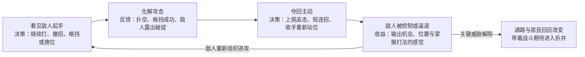
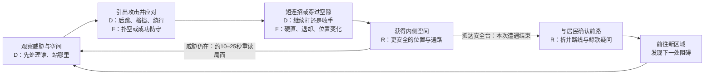
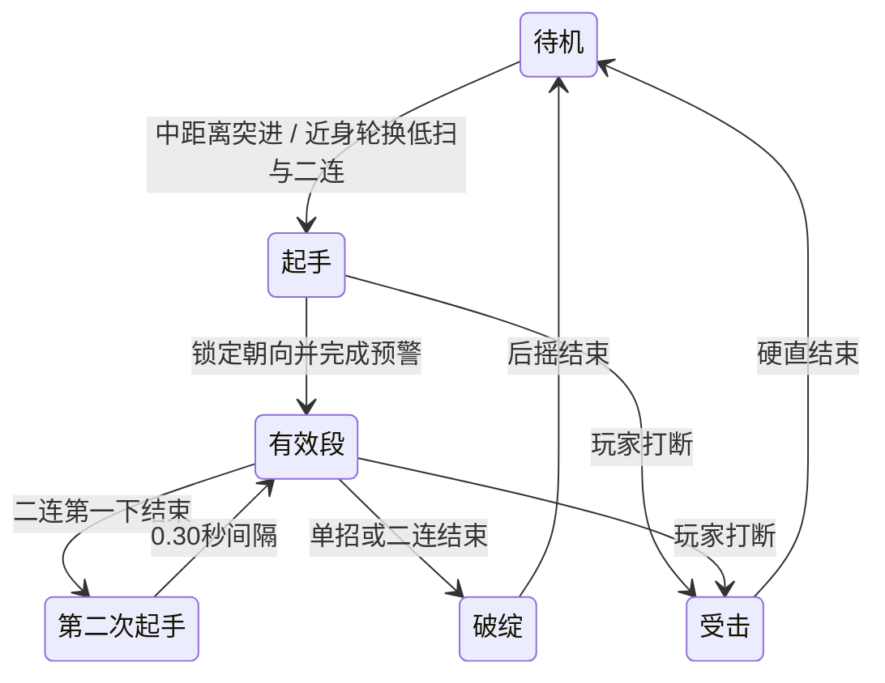
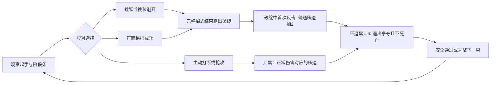

# 第一章游戏循环设计 · 灯在鲸须间

2026-11-17，v0.1，待试玩验证的设计提案。依据[主线叙事初稿](主线叙事初稿.md)第一章和[世界观与人物设定初稿](世界观与人物设定初稿.md)。本稿细化可玩流程，不修改故事定稿，不代表已接入当前19房主线；下列节点只是设计标记。

当前实现边界：已有[位置对话与字幕能力](dialogue-system.md)，并制作了[压缩的单遭遇循环样板](第一章循环试玩.md)，可体验观察、两只占位敌人、非击杀通行和战后目标。补巢者实体、食腐甲独立动作及完整10–15分钟章流程仍待实现；玩家动机与节奏尚未验收。

首次试玩未通过，主要问题及修订证据见[循环试玩修订记录](第一章循环试玩.md#2026-11-18-首次试玩反馈后的修订)。当前判定改为跨过聚食区即记录通过、落地自动交流；骨拱真实通往折井入口，以下灯旁停稳及终点字幕为首版设计历史，待后续整章编排统一修订。

## 2026-11-18 · 从流程样板转向战斗吸引力

用户第二轮反馈：整体流程更流畅，但缺少吸引人的点；战斗应让人愿意继续第二章；第一章能直接跳过，不到一分钟结束。此结论优先于上一版“正面交战或绕行都算核心验证成功”的假设。当前样板只证明引导、通行和结果能衔接，尚未证明战斗有吸引力。

下面是下一版设计提案，尚未实现。下文原12分钟表与全绕行通行规则保留为历史依据，当前调整以本节为准。

### 一句话战斗体验

**敌人压上来时，玩家用一次及时应对夺回主动，把刚才的威胁变成自己的一套连招。**

最先验证一个具体时刻：玩家出招过深，看到敌人起手，用后跳打断自己的动作躲开攻击；敌人扑空后，玩家回身接近、上挑、追击，最后把它打退。格挡、预先走位也能制造进攻机会，不要求背固定键序。

这一时刻连接已有后跳强制取消、白影、上挑、三段斩、受击控制和命中反馈。它们都需要真实敌人动作窗口支撑；玩家拥有很多技能，不代表已经有理由使用它们。第一章先让三四种动作各有用途，熟练者可自行扩展。

### 章节编排：每段增加一种战斗判断

首次游玩以10–15分钟作为内容目标，先按约11分钟预算编排；所有时间仍需玩家实测。熟练者可以更快。不得用行走速度、等待冷却、强制文字时长或敌人血量硬凑分钟数。

| 预算 | 玩家经历 | 新的判断与记忆点 |
| --- | --- | --- |
| 0–1分钟 | 短开场，追歌接近聚食者，很快遇到第一次主动扑击 | 第一分钟内进入真正攻防，先让玩家操作，居民说明随后补足 |
| 1–3分钟 | 单只低风险交战，在相对宽阔处学习读招、撤招与反击；随后一只同类在较窄位置出现 | 同类招式保持可读，玩家能把第一次学到的方法主动再做一次；不能每只都重新教 |
| 3–5分钟 | 一只近身驱赶，另一只占据侧路；玩家选择先压退谁、是否用上挑控制一只、如何避免夹击 | 群战的亮点是控制与位置带来优势，不只提升两只的追逐速度 |
| 5–6分钟 | 到居民安全处，确认刚才清出的通路被使用；可恢复，能看见前方大甲阻挡骨拱 | 喘息、结果反馈和压轴预告；可选观察位有真实战术信息，主线不要求搜集数量 |
| 6–9分钟 | 与守住窄口的大甲交战：短连扑、较重压击、扑空后明显失衡 | 已知防守方法仍有效，但贪完整连段会被反制；玩家要决定打多长、何时收手。化解重攻击后有一次足够展开追击的长窗口 |
| 9–11分钟 | 大甲被逼退、骨拱真正可通行；居民给出下层路线，主角确认歌声来自那里，进入折井 | 战斗使行动目标变得可执行；下一章预告一个不同的对手或约束，留下“刚学会的打法还能怎样用”的期待 |

每段预算包含接近、判断、实际交战及结果，不是要求单只敌人活满两分钟。这里的单只、群战、窄口精英是三段不同职责的内容；若仅靠复制同一只怪物、同一招式和增加血量实现，视为设计未落地。

### 压轴对抗如何有区别

暂称“窄口大甲”，是野生威胁的精英样板，不替代第二章负壳守卫的首次主要人物对抗。正式身份、素材和故事安排仍需与主线稿统一。

| 敌人行为 | 玩家面对的选择 | 有效应对后的结果 |
| --- | --- | --- |
| 可辨认的短连扑，第二次落点与第一次方向一致 | 站在原地打到底、及时后跳，或预先换到侧面 | 避开连扑后取得短反击机会；第一下躲开不等于能立刻贪长连招 |
| 前摇更明显的重压 | 拉开、格挡或利用空间避开；危险由实际攻击判定产生 | 重压扑空或被成功格挡后，大甲出现可见失衡，开放较长追击窗口 |
| 从失衡中恢复、重新护住通路 | 继续追击，还是提前收手准备下一轮 | 提前收手保持主动；贪招承担下一次敌人攻击风险，不靠不可见的阶段伤害惩罚 |

所有攻击仍然可读、可避、可反击；不偷读玩家按键瞬时变招。普攻可以完成对抗，不强迫某个技能作为钥匙；会撤招、格挡或利用浮空追击的玩家应明显更安全，且更能把握输出机会。是否确有这种差异必须实测，不能只写在描述里。

### 调整通关规则

普通遭遇可以绕行或快速突破，允许玩家选择节奏；**本章压轴威胁必须实际解决，才能取得进入折井的通路。**

空间上先让玩家看见大甲占据窄口与骨拱的关系。解除威胁后，敌人退开、通道明确开放，并且真的可以通行。不能仍用“跑到某条x坐标”宣告整章完成，也不能用看不见的锁门边界假装敌人阻路。

这种调整明确改变了首版整段跳跃可完成的规则。允许越过普通敌人不等于允许完全绕过战斗核心。判断章节完成的收益归属应是“我解决了威胁，才能继续追歌”，而非“我跳过了所有内容，剧情自动结束”。

### 当前漏洞与补法

| 编号 | 图上位置 | 证据 | 缺失与后果 | 补法与状态 |
| --- | --- | --- | --- | --- |
| H-6 | 观察→应对→追击 | 用户认为没有吸引人的点；当前上路可以全程不接近攻击覆盖 | 没有一次让玩家记住并想复现的攻防转化 | 先做短精英样板，验证撤招/防守转入追击是否吸引人；提案 |
| H-7 | 战斗收益→章节完成 | 用户直接跳过后不到一分钟结束，现规则只要求越过聚食区 | 主体验有更便宜的完整旁路，战斗改得再好也可能无人体验 | 保留普通遭遇绕行，压轴对抗必须解除实际阻路；提案 |
| H-8 | 章节时间轴 | 当前是单遭遇原型，原设计表中的分钟数没有对应内容量 | 宣称10–15分钟没有依据，读对话也无法补足战斗节奏 | 单只、混合威胁、喘息、精英、结果各有职责后测时长；未制作 |
| H-9 | 通关结果→第二章期待 | 用户没有因为战斗而想继续 | 新目的地只提供剧情坐标，没有形成战斗期待 | 让玩家先获得明确的操作成就，折井预告不同约束；提案，不能只靠文本说“后面更精彩” |

### 下一轮先验什么

先把窄口精英做成可玩样板，避免先扩地图却继续没有亮点。该样板只用已有战斗能力与必要敌人规则，验证通过后再接入上表的第一章编排。

- 三名首次玩家中至少两名，在被压迫后主动尝试改变应对，并至少再次主动复现一种有效的攻防转化；不是照提示完成一次就算通过。
- 至少两名能说出一个具体战斗时刻及自己的选择，并愿意再打一轮或继续下一段。直接问“爽不爽”不足以作为证据。
- 两条有效打法均可完成，不能只有按指定连招键序；持续站定普攻应有可解释的风险，而非最省心的通解。
- 不交战能否从上路越过压轴进入第二章，是必须执行的反例测试。应由可见的敌人与关卡结构阻挡；若只能靠空气墙，先修空间。
- 完整章接上后分开记录探索、对话、战斗、死亡重试的时间。若熟练首通仍不到一分钟，检查是否有旁路或缺失内容，不拉长敌人生命补数字。

若精英样板依旧不能让玩家记住一个战斗选择，优先改攻防关系或删掉无效招式，再讨论章节长度。这个顺序不能被“功能都做完了”替代。

## 本章要验证什么

玩家能否因为想追上鲸歌、弄清居民处境，主动穿过一次有选择的战斗，并在结束后想继续进入折井。

战斗操作沿用已验证的连招、后跳、格挡和方向派生。全局方向是近战动作加剧情章节推进，不做刷装循环。本章优先让玩家掌握短击、后跳和一次续招，不要求把整张技能表背完。

首次游玩目标10–15分钟，以约12分钟编排。熟练玩家允许更快通过；不以锁门、强制读字、等冷却或重复刷敌填满时长。若实际内容只有6分钟，先看体验是否完整，再决定是否增加内容。

## 12分钟流程草案

| 时间预算 | 节点与玩家目标 | 玩家实际做什么、选择什么 | 当场反馈与收益 | 为什么进入下一段 |
| --- | --- | --- | --- | --- |
| 0:00–1:00 | A：穿过巡视缝，找回中断的歌声 | 移动、跳过一处低落差；碰触可接近的须板，决定先看深处灯光还是检查附近回声 | 须板接触有声音回应；看见微小居民与巨大遗骸的尺度 | 须板不能回答歌声来源，灯光处有能交流的生命 |
| 1:00–2:30 | B：接近补巢者，确认这里能否继续走 | 主动共鸣交流；可略看修巢动作和避流凹处，得知侧道有聚食者 | 得到具体的通行警告和侧道方位；居民会回应“外来者” | 深处再次出现短促鲸歌，玩家有方向，也知道前方存在危险 |
| 2:30–4:00 | C：接近聚食区，寻找安全起手位置 | 从同一入口的上沿观察点或下方短路接近；观察食腐甲前扑，决定先引开还是直接迎击 | 高处能看见第二只所在位置；下路更快但更容易同时惊动两只 | 交战由接近触发，开始争取内侧通路 |
| 4:00–5:30 | D：应对第一只食腐甲 | 读前扑提示，选择后跳、格挡或先退开；扑空后短击接一次续招 | 明确的扑空、硬直和命中反馈；成功逼退第一只，得到可站立的内侧空间 | 第二只从侧面接近，刚学到的应对需要换位置使用 |
| 5:30–7:30 | E：处理侧面压力，穿过须板 | 先用须板分隔两只，再逐一压退；也可抓准空隙快速突破。战斗区预留换向与后跳落点 | 玩家能看见两只无法同时夹击；到达内侧安全台后，食腐甲退回聚食处，追击结束 | 已取得通行位置，补巢者从安全处靠近，交流重新开放 |
| 7:30–9:00 | F：确认刚才的结果 | 短距离走到另一侧补巢者旁，可看见食腐甲回到食物附近；主动询问鲸歌与前路 | 补巢者明确指出通往折井的下降路，却听不懂玩家描述的低鸣；这里的收获是路线信息与新的疑问 | 玩家知道去哪里，也发现鲸歌并非所有居民都能听见 |
| 9:00–12:00 | G：走向折井，带着疑问离开 | 沿下降路前进；路边可停看回流浑水。末段先看见第二章的封闭刻痕，再跨过章节边界 | 浑水旋回与前面避流住巢形成联系；看见守卫通行标记，预告下一种阻碍 | 追歌目标仍在，新的问题是“前路为什么有人封住” |

C至E属于初稿中的同一次 N01-01 遭遇，内部拆成接近、单只应对、双只换位，不增加三场独立清怪房。F至G不再出敌，给玩家消化战斗与信息的时间。时间均为设计预算，不是运行测量。

## 核心循环与接口

D表示决策，F表示反馈，R表示本轮收益。

秒级战斗循环可在一次遭遇中重复数次；章节推进则是有限流程，第一章完成后不强迫回到起点。反复出现的是“观察—行动—看后果”的结构，下一次面对的对象和问题发生变化。

本章胜利条件提案是**取得并站稳内侧安全台**，不以全歼或连击评分开门。正面压退与利用空隙突破都成立，后者是允许的操作解法。安全台必须在触发前可见，居民留在敌人活动范围之外；不能靠透明空气墙临时切断敌人追击。

## 收益与代价

| 行为 | 付出与风险 | 独特收益 | 防止变成空操作 |
| --- | --- | --- | --- |
| 观察 | 少量时间，接近时可能惊动敌人 | 提前看见第二只，选择单独交战位置 | 观察点必须真能看清路线和敌人，不只多一句说明 |
| 连招压退 | 停留在近身范围，贪招会被另一只夹击 | 较快争取空间，亲眼看到所学操作生效 | 敌人必须可控、有退却反馈，不靠加血拖时间 |
| 后跳、格挡与换向 | 放弃当前输出，格挡需掌握时机 | 化解前扑、重建站位，保住下一轮进攻机会 | 失败能看出时机或位置原因，不能要求唯一标准答案 |
| 借空隙突破 | 承担穿越威胁区的风险 | 更快取得目标位置 | 能否到达安全台由真实空间与敌人覆盖决定 |
| 主动交流 | 短暂停步；不要求读完全部可选内容 | 获得准确路线，发现居民听不到鲸歌 | 不交流也有可辨认的下降路，但交流提供更明确的解释 |

本章不发随机装备、重复货币或强制战斗评分奖励。永久收益主要是已知路线、遭遇完成状态与人物回应；战斗收益是玩家掌握了如何制造进攻机会。是否在章节末学习新技法留待全章成长节奏设计，本章先不添加技能奖励。

## 失败、中断与重试

- 进入聚食区前设置明确的安全恢复点。失败回到该点，保留已完成交流；提供立即重试，避免重复开场对白。复活的世界观规则仍以设定稿中的待讨论状态保留。
- 遭遇未完成时撤回入口安全区，可以恢复后重新接近；两只敌人回到原聚食位置。重置范围和边界需让玩家看得懂，不能在攻击落点瞬间回血。
- 遭遇完成后，同一次通过路线不再重新拦截；折返探索不强迫再打一遍。休息/读档后普通敌人的刷新规则需全局统一，不能由第一章单独决定。
- 暂停或阅读交流时，战斗不能继续伤害角色；居民交流只在安全区开放。战斗中不能靠打开普通对话获得无敌。
- 安全台判定只需玩家进入安全范围并落稳，建议0.5秒后确认；不强制朝向、招式、击杀或Combo数。

## 预期节奏

| 节点 | 挑战强度（1–5） | 新信息密度（1–5） | 情绪重点 |
| --- | --- | --- | --- |
| A：进入须庭 | 2 | 2 | 巨物尺度、歌声中断 |
| B：居民交流 | 1 | 4 | 遗骸内部有人生活 |
| C：接近聚食区 | 3 | 2 | 看见危险、决定起手 |
| D：单只应对 | 4 | 2 | 第一次主动化解攻击 |
| E：侧面压力 | 4 | 1 | 用位置和连招突破 |
| F：战后交流 | 1 | 3 | 居民与野生威胁的边界、鲸歌差异 |
| G：走向折井 | 2 | 2 | 回流异常、封锁预告 |

首次实质交战目标落在第4分钟左右；只有关键操作给短提示，其余连招可查看底部技能页。双只压力时不同时弹出世界观正文、新招教学和任务大字。G段如果连续90秒只有向前走，优先缩短路程，不新增填充战斗。

## 漏洞台账

| 编号 | 来源图与位置 | 证据 | 为什么是洞 | 补法方向 | 状态 |
| --- | --- | --- | --- | --- | --- |
| H-1 | 战斗循环D→E，通路收益 | 叙事初稿写逼退后指路，未定义玩家何时算通过 | 容易做成清完血条才播对白，通行目标不可感知 | 采用可见内侧安全台和停止追击范围，分别反馈通过与退却 | 本稿提出，待空间验证 |
| H-2 | B→C，首次行动动机 | 补巢者让来客等巡视，主角却立即追歌 | 如果等待真会让NPC清怪，玩家可能绕过整段体验；如果是空话，玩家会误等 | 暂按可回退的背景警告处理，不提供挂机自动通关；短促鲸歌和可见路线引导主动前进 | 待测试理解，不改成强制倒计时 |
| H-3 | D/E，应对后获得进攻机会 | 玩家此前发现敌我只能换血；现角色已有后跳和格挡，敌人编排尚未验证 | 即使操作齐全，敌人若无读招和扑空窗口仍会换血 | 单只先露前扑，首次双只错开起手；检验绕须板是否真能分隔敌人 | 待敌人样板验证 |
| H-4 | E→F，胜利后的操作 | 初稿为敌人缩回、补巢者指路，未规定镜头和控制 | 若立刻切演出，玩家无法确认胜利来自自己的突破 | 保留控制，走到安全处再交流，敌人原地回到聚食行为 | 本稿提出，待试玩 |
| H-5 | F→G，战后低强度路段 | 10–15分钟是体验预算，现有内容未测时长 | 为凑时长可能安排三分钟空走，磨掉继续探索的兴趣 | 优先压缩路程，用可见回流和封锁预告承接；熟练玩家可快速走过 | 保留风险，不按预算硬拉时长 |

## 验证计划

以下均未执行。先做小范围样板，找3名未参与设计的玩家各试玩一次；阈值是本轮决策标准，不是行业结论。

| 假设 | 怎么观察 | 首轮判据 | 若不成立，优先改什么 |
| --- | --- | --- | --- |
| 玩家理解当前目标是通过聚食区 | 通关后问“刚才为什么战斗，做到什么就能继续” | 至少2/3能说出取得通路，不只说清怪 | 安全台可见性、人物警告和通过反馈 |
| 玩家会主动使用防守建立进攻机会 | 记录真实攻击与防守；首次受击后观察下一次同招应对 | 至少2/3在后续同类攻击中主动尝试后跳、格挡或预先换位 | 先查读招、扑空时长和地形，再判断是否需改角色参数 |
| 须板空间产生可理解的战术差异 | 观察是否从两面受压改成单侧交战，事后问原因 | 至少2/3能描述自己选择的站位或路线 | 调整遮挡和接近路线，避免装饰须板没有实际空间作用 |
| 战后信息带来下一步动机 | 不弹任务箭头，让玩家选择前进；问为何想去折井 | 至少2/3能复述鲸歌仍在深处或补巢者给了路线 | 加强前后线索联系，缩短战后空走，不先补奖励货币 |
| 开场节奏符合内容体量 | 每30秒记录操作、停顿和死亡；区分主动观察与迷路 | 首次失败前4–5分钟进入交战；无连续90秒纯跑路或无目标等待 | 压缩路线/文字，调整敌人位置；不为达时长增加波次 |

## 尚未展开的设计

第一章能否成立，先看上述验证。本轮仍未定义完整的章节成长曲线、所有敌人刷新规则及复活叙事；也未决定第二章Boss后的具体技法奖励。食腐甲的正式动作、退却表现与补巢者交付需单独制作，现有尸蟹只能明确标为验证占位。

当前19房主线是可复用的运行工程，不等同于这份12章叙事已经实现。下一步可将C至F做成一次完整样板，先验证“看懂威胁—应对突破—看到结果—获得新目标”，再扩写其余章节。

## 2026-11-18 · 读招与输入容错样板

本轮只加强现有聚食区的秒级战斗循环，尚未扩写完整章节时长。三招复用已有尸蟹逐帧素材，不作为三套新动画交付。

| 招式 | 起手 / 有效 / 后摇（秒） | 玩家选择 |
| --- | --- | --- |
| 低扫 | 0.62 / 0.20 / 0.85 | 跳过低判定、格挡或后跳后反击 |
| 冲撞 | 0.80 / 0.38 / 1.10 | 预先越身或拉开，利用锁朝向和长后摇；有效段内首次接触结算 |
| 二连钳 | 0.48 / 0.18 / 0.30再起手 / 0.18 / 0.95 | 不把第一下结束误认成完整破绽，也可主动打断 |

| 漏洞 | 图上位置与证据 | 后果与本轮补法 | 状态 |
| --- | --- | --- | --- |
| H-6 | 待机→起手；此前只有一次前扑 | 无须区分攻击；增加距离选招、低扫与二连轮换 | 已接入隔离样板，真人难度待评 |
| H-7 | 玩家输入→动作；旧输入仅接受修饰键先按，停顿中不采样 | 合理输入丢失；面键先按最多等60ms，Q/E或方向在窗口内补齐即识别，已成组合立即出招 | 共用主线/白盒输入已接入 |
| H-8 | 动作后摇→下一招；旧缓存仅约跳跃缓冲时长且主要覆盖进攻 | 提前按防御容易落空；下一招缓存200ms、单槽覆盖，仍校验资源、冷却与取消窗口 | 已接入，强制后跳仍立即执行 |

边界：60ms后已释放的单键不会被迟到修饰键重新改招；已有Q/E选招页仍保留0.8秒。输入锁、受伤、死亡和后跳清空等待，保持面键不自动重复；Shift作为立即基础冲刺备用。已形成方向组合的按键立即识别，不再等待第三个键。单键I格挡和J普攻可能增加最多约60ms等待，须由真人确认是否值得；若防御迟滞明显，优先缩短窗口或单独提供立即格挡入口，不通过提前取消攻击有效段掩盖输入问题。

后跳修订：上一版把A/D+L视为完整方向组合，立即发撞击，导致L→S容错在移动中失效；后跳入口还只看L的just_pressed，命中停顿中无法补S。现在由共用输入保留L到窗口结束，S+L在窗口内优先识别并交给原强制后跳入口。已形成的A/D+L也不能提前结算；Z、移动、跳跃等无竞争输入仍即时。先以回归区分优先级缺陷与窗口长度问题，暂不把60ms一概加到所有按键。

## 2026-11-18 · 读招后反击的收益接入

| 漏洞 | 位置与证据 | 后果 | 本轮补法与边界 |
| --- | --- | --- | --- |
| H-9 | 起手→有效：此前三招共用固定0.7秒图集节奏 | 招式真实时长与画面不同，文字提示承担全部辨识 | 独立样板视觉适配器，依据PATTERNS实际时长取帧；冲撞低姿等待/走帧突进、低扫渐次抬钳、二连高举；仍是现有素材复用，需要新动画时另行创作 |
| H-10 | 破绽→收益：此前任意伤害累计3即撤退 | 一次重击就能跳过读招；防守没有进攻收益 | 阈值6，破绽内首击额外+2，按攻击序号去重；普通攻击仍能压退，不强制指定操作 |
| H-11 | 格挡→下一状态：此前格挡只免伤，二连照常接第二下 | 格挡成功缺少敌人的可感知反馈 | 本次真实格挡从未成功变为成功时立即进入recover并取消二连，保留既有格挡时机/正面校验 |

两只怪首次起手增加0.35秒错峰，后续独立运转；这不保证永远不会同时攻击。头顶金条显示累计压退，细青条在起手增长、破绽倒计时；反击奖励每个attack_serial只计一次。退回入口清空本次压力与奖励记录，进度不写永久死亡。

新增能力只接入第一章隔离遭遇；共用尸蟹仅增加可覆盖的视觉构造入口，普通主线尸蟹沿用原视觉与行为。60ms输入容错和200ms预输入保持不变。验证重点是玩家是否看懂二连尚未结束、是否会在成功防守后追击，以及相比抢攻是否值得；自动测试通过不代表难度或吸引力已成立。
