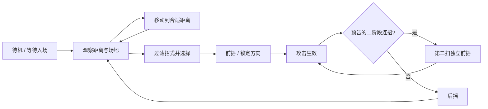

# 主角 × 负壳蟹：Boss 战原型方案

2026-10-28。状态：设计提案，尚未实现或试玩验证。本轮只定方案；以下新增规则、时间和数值均为首轮调校起点。

## 目标与范围

用一个平地竞技场、一名主角、一只负壳蟹，验证「读前摇 → 移动或跳跃躲避 → 抓后摇反击」是否清楚、顺手、有节奏。目标熟练通关时长先设为 60–90 秒，实际以试玩调整，不靠单纯加血延长。

第一版包含三招、半血连招、受击/胜负反馈、快速重试；暂不加入小怪、平台机关、装备、格挡或复杂破壳系统。复用既有世界观和角色，不新增正式剧情。

原型安排独立入口、独立运行状态，进入即到竞技场，死亡或胜利后可重试。默认不读写主线存档，不授予主线能力和胜利标记。复用主角控制器与战斗组件，正式主线接入留给原型验收后的批次。

## 当前基础：已读源码，未在本轮运行验证

| 模块 | 当前已有 | 原型要解决 |
| --- | --- | --- |
| 主角 | 204.8 px/s 移动；跳跃初速度 460、重力 1000；100 ms 土狼时间、120 ms 跳跃缓冲 | 短跳/长跳、连击缓存、动作取消规则与判定可读性 |
| 战斗 | 短击 10/14、重击 24；治疗 1.1 s；4 格生命；重击/治疗消耗 2 蓄振 | 防止贴身乱按稳定取胜，确保移动/跳跃都有有效用途 |
| 螃蟹 | 180 血，接近、前摇、攻击、后摇；横扫、下砸、半血二扫 | 招式视觉和应对方式区分；远处发呆、背后安全输出与选招节奏 |
| 镜头 | 跟随主角；战斗时缩到 0.68，固定到写死的房间坐标 | 从竞技场范围配置取景；平滑入场并保持主角足够大 |
| 资源 | 主角姿态帧、螃蟹静态图和已有特效位图 | 螃蟹独立招式姿态/动画尚需制作，静态旋转不能算动作动画 |

依据：[主角参数](../../game/src/player/player_tuning.tres)、[动作](../../game/src/player/states/actions.gd)、[敌人](../../game/src/enemies/enemy_base.gd)、[镜头](../../game/src/main/camera_rig.gd)、[资源清单](../../game/art/manifest.json)。

当前主线在胜利后才解锁冲刺。因此基准模式不带冲刺，每招都必须能靠移动和跳跃躲避；原型可另设「已解锁冲刺」对照模式，只改变本次训练状态。

## 3C：Character、Control、Camera

### Character：轻巧的主角，对抗沉重的蟹

- 主角保留立即起步/停步与空中横移，先沿用现有速度、重力和攻击伤害，减少同时变化的参数。
- 跳跃保留土狼时间与输入缓冲，新增松键提前收跳；长按仍使用当前完整跳跃高度。现有参数理想离地高度约 106 px，需用实际碰撞确认能越过低扫和横冲。
- 轻击能边走边打，沿用攻击时 55% 移速。重击承担更长动作承诺，适合下砸/横冲后的大空隙。普通攻击不打断 Boss，避免无限压制。
- 受击只扣一次，保留击退与 1 s 无敌；明确闪烁、声音与生命变化。关闭攻击判定后再进入受击状态。
- 原型先保留 4 血、4 蓄振和现有蓄振获取规则。治疗是放弃输出换恢复的选择，下砸与横冲后要留出实际可用窗口。
- 命中停顿初值：轻击 35 ms、重击 60 ms；需要同时暂停双方招式计时与判定，保留输入缓冲，避免暂停期间偷偷出招。

### Control：沿用键位，明确动作承诺

| 操作 | 键位 | 规则提案 |
| --- | --- | --- |
| 移动 / 跳跃 | A、D / Space | 短跳与长跳；攻击仅在下述可取消窗口允许起跳，受击硬直中禁止 |
| 轻击 | J / Q | 两连击；第一击末尾 150 ms 缓存下一次按键，只排队一击；持续按住不自动循环 |
| 重击 | K / R | 消耗 2 蓄振；前摇和生效段不能取消，后摇末尾 150 ms 可跳跃或冲刺取消 |
| 治疗 | F | 原地 1.1 s；开始扣能量，受击中断且不退款，UI 说明消耗 |
| 冲刺对照模式 | Shift / L | 沿用 0.22 s、166.4 px、0.8 s 冷却及现有短暂无敌窗；不新增整段无敌 |
| 暂停 / 重试 | Esc / 结果界面按钮 | 暂停冻结双方；重试统一清空判定、计时、冷却、输入队列与阶段 |

轻击前摇和生效段不可被另一攻击取消，后摇末尾 150 ms 可接跳跃/已解锁冲刺；跳跃取消只终止剩余后摇，不重复结算命中。动作优先级为死亡 > 受击 > 当前不可取消段 > 一次缓存动作 > 普通输入。同帧不能同时花费重击和治疗资源。

### Camera：优先看清双方和躲避空间

- 采用单屏竞技场，镜头中心、边界与安全留白写在场景配置里。可战斗地面先取约 1000–1200 世界像素，再按已有场景素材和实际角色比例调整。
- 进入后约 0.4 s 平滑过渡到场地取景，镜头稳定再开始第一次前摇；战斗中固定中心与缩放，不随左右转身摇摆。
- 以 1280×720 为首轮基准，主角画面高度目标不低于约 55 px；双方、攻击落点与两侧退路同时可见。达不到时先缩小战斗范围。
- 轻击不震屏；重击命中与下砸落地可给 2–4 px、80–120 ms 的短震动，提供关闭选项。Boss 血条、玩家生命/蓄振固定在屏幕边缘。
- 第一版不做慢镜头或大幅推拉。胜负、暂停、重试都不能遗留上一状态的缩放或震动。

## 三个招式：提示、躲法、奖励一一对应

表中范围是策划起点；最终判定以脚底为基准，与实际位图姿态对齐。距离判断用双方身体边缘间距，不能混用中心距离。

| 招式 | 视觉提示 | 前摇 / 生效 / 后摇 | 玩家应对与反击 |
| --- | --- | --- | --- |
| 低位钳扫 | 钳子横向后收，身体压低 | 0.75 / 0.18 / 0.85 s | 前方约 170 px、离地约 45 px 的低扫；跳起或退出范围，落地接轻击 |
| 双钳下砸 | 双钳抬高、躯干直立，落点清楚 | 1.00 / 0.18 / 1.40 s | 前方约 130 px、约 145 px 高；向后撤出，避免原地跳进钳子；可重击或治疗 |
| 横向冲撞 | 压壳、收钳、短促扒地，准备横移 | 0.90 / 最长 0.65 / 1.40 s | 锁定方向后约 420 px/s、最多 270 px，起点到终点连续判定；低姿态判定约 65 px 高，起跳越过或提前让开 |

横冲仅在距离与剩余空间合适时进入候选；不得瞬移、穿出竞技场或穿墙继续判定。冲撞姿态必须支持其低判定轮廓；如果现有蟹外形做不到，就补制低姿态素材并调整数值，不能让玩家视觉上撞壳却被要求穿过去。

后摇长度不等于必然安全：需要把躲避后的落地/靠近时间一起算入。实测要求轻扫后至少可靠打一击，另外两招至少能在正确站位完成一次重击或治疗。所有攻击首轮伤害为 1 格。

身体本身首轮不造成接触伤害，也不堵住主角，避免贴边被夹死；只有明确出招才伤人。绕后是允许的替代解法，AI 在一轮结束后转向重新接战，不能因为玩家绕后就长期停止攻击。若试玩中走穿身体成为压倒性的最优解，下一轮再评估站位和攻击覆盖，不在本轮加无提示的背后伤害。

## Boss AI：状态机执行，条件和权重选招

执行状态另含阶段转换、死亡和重置。第二扫不可再次派生第二扫；死亡优先于任何状态，立即清掉攻击判定。

1. **感知：** 只使用玩家位置、距离、朝向、是否在地面、Boss 血量、可用地面和招式历史；不读玩家按键或未来输入，也不因按下治疗立即强制反制。
2. **接近：** 玩家远离时持续接近，不沿用当前 500 px 外停止响应的门槛。接近和转身通常只发生在观察/移动阶段，唯一转身例外是下述横冲前摇前段；不得在后摇里滑步追人。
3. **选招：** 身体边缘距离 0–100 px 时横扫:下砸初始权重 65:35；100–220 px 优先接近，满足横冲条件时可选横冲；220–350 px 且有足够地面时优先横冲，更远则接近。下砸冷却 4 s、横冲冷却 5 s，从招式完成时开始计；同招最多连续两轮，没有候选就移动后重评估。
4. **锁定：** 横扫/下砸进入前摇即锁朝向与攻击范围；横冲前摇前段可转身，但最后 0.35 s 固定方向，提示同步定住。出手后不追踪或突然翻面。
5. **二阶段：** 首次降到 50% 血，完成当前整轮招式后，给 0.8 s 明确的转阶段姿态；仅转换一次，期间停攻但可受伤。横扫改成已预告的两连扫，第二扫有 0.55 s 前摇，两扫均保持首次锁定方向。完成整套后才开始 0.85 s 后摇，不把半途跨半血变成无提示追加攻击。
6. **防重复与公平：** 第二阶段优先增加组合变化，暂不加伤害或全面加速。前摇、有效帧与提示绑定同一招式时间轴；暂停/命中停顿不改变它们的相对关系。

实现先用显式状态机加小型招式配置，不需要完整行为树框架。蟹专属选招与阶段从通用 `EnemyBase` 分出，共用 `Hitbox/Hurtbox/Health`。调试输出包含当前状态、招式、锁定方向、阶段、冷却和选招原因；测试使用固定随机种子复现，玩家界面不显示这些内部字段。

## 运行能力、创作交付与接入验收

- **运行能力：** 独立竞技场入口/重试、动作缓冲和取消、三招状态机、半血整套连招、场地镜头、战斗反馈、只读调试状态。参数集中在主角资源和 Boss 招式配置。
- **创作交付：** 复核主角各动作帧；螃蟹至少需要待机、移动、横扫蓄力/挥出/收招、抬钳/下砸、压壳/横冲/刹停、转阶段、败退的可辨认姿态。先完成关键姿态验证读招，再补正式逐帧过渡；具体帧数以时间轴和制作验收决定。新素材依照[美术风格](../../assets/art-style.md)与[资源管理](../../assets/README.md)入库，不能用静态旋转冒充制作完成。
- **接入验收：** 逐招核对提示、生效时刻、武器/身体轮廓、命中范围、脚底接地、翻面锚点、镜头可见性；检查左右两侧和贴边状态。新增缺失姿态应先制作再接入，不能用程序几何代替正式视觉。

## 分批与验收标准

1. 第一批：独立入口、3C、单横扫、重试；验证移动/跳跃/攻击的基本节奏和镜头。
2. 第二批：下砸、横冲、选招和半血二扫；补齐对应姿态并验证公平性。
3. 第三批：完整按键试玩、参数调校、音画与性能复核；通过后再决定主线接入和发布。

以下五组均为**待执行**，本轮没有把源码阅读或历史测试记成原型通过：

| Case | 方法 | 通过标准 |
| --- | --- | --- |
| 3C 与取消 | 测土狼时间、落地前缓冲、连击/重击末尾输入、同时按攻击与治疗 | 缓冲只消费一次；不可取消段不被跳过；不重复扣能量；命中只结算一次 |
| 三招可解 | 无冲刺、逐招真实按键，测试左右两边和贴边；分别晚躲一次 | 正确操作能躲开并反击，错误操作原因可见；横冲不会越界或无提示转向 |
| AI 与阶段 | 固定种子运行；远离、绕后、空中、攻击途中跨半血 | 不远处发呆、无限同招或追踪翻面；半血仅切换一次，二扫事前可读 |
| 完整战斗 | 无冲刺/有冲刺各试玩，记录胜负、时长、每招受伤、治疗机会 | 无冲刺可胜；各招预期躲法均成立，绕后可行但不能长期停在背后无风险输出；站定连按不能稳定获胜；正确抓后摇有实际回报 |
| 生命周期与镜头 | 前摇/生效中暂停，受击死亡，胜利后重试，切换入口 | 判定/计时同步冻结和恢复；无遗留攻击与阶段；双方始终可见；主线存档字节不变 |

实施时依照 [Godot Skill](../../.agents/skills/godot-game-dev/SKILL.md)运行 `check`、`test` 与独立浏览器真实按键路线，检查素材与截图。上述 60–90 秒、各招时序和画面尺寸都是待测目标，不能据此宣称平衡完成。

现有浏览器通关脚本会观察 AI 状态和计时，它能验证按键路线与战斗规则，但不能替代只看画面、不读取内部状态的人工读招试玩。
