# 鲸落的十二种可能

小团队游戏概念策划册 · 2026-10-21

独立于本地既有玩法设计。默认 PC 单机、2—4 人、2D 或固定视角 2.5D。本文是立项级概念策划，原型数值与工期需要试玩和团队产能验证。

## 01 鲸落花园

> 用一头鲸最后的养分，养出一个不再需要你的海底世界。

生态修复 × 轻策略｜3—4 人｜原型 3 周｜完整制作 6—9 个月｜25—40 分钟 / 关

### 1. 体验定位与场景（场景分镜 1）

场景：从鲸体到海床的空间梯度。

喜欢自然、建造与低压规划的玩家

固定斜俯视镜头覆盖一处鲸落：左侧尚有软组织，中部露出肋骨，右侧是贫瘠海床。玩家是微型生态维护机器人，场景随养分转移逐步亮起；最终主动撤掉干预设施，把舞台留给生物。

### 2. 操作与即时反馈（场景分镜 2）

操作：放置菌毯并预览覆盖范围。

鼠标选择生物群落，拖入栖息格，悬停显示未来两轮的养分收支；空格推进一轮。先引入食腐者释放可用养分，再培养菌毯，最后接续依赖骨区的群落。每次操作应同时改变空间外观与生态账本。

### 3. 关键取舍（场景分镜 3）

取舍：即时养分与骨区储备。

第 6 轮软组织剩 8：新增两个食腐群落能快速扩张，却让食物更早耗尽；用 4 点养分启动菌毯，短期少一个群落，后期则有接力来源。需要玩家预判交接，而不是不停点击升级。

### 4. 目标与成长回报（场景分镜 4）

回报：设备撤走，生态仍然存续。

普通关：拥有 4 类群落，在撤掉全部临时设备后连续 3 轮无缺粮，且保留骨储量 ≥6。全部群落失活则失败；允许回退本轮，避免轻策略玩家被隐蔽连锁惩罚。

从完整鲸体、散落骨区到海沟斜坡共 6 张手工地图；每关只增加一个环境变量。解锁的是新物种和布局方式，不是永久数值碾压。结算生成同机位前后对照图，作为可分享的成果。

### 5. 可执行规则与决策

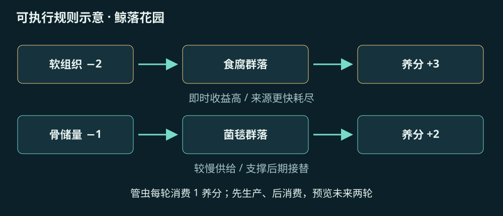

原型采用 8×8 格、3 种资源：软组织、骨储量、可用养分。食腐群落每轮消耗软组织 2、产养分 3；菌毯每轮消耗骨储量 1、产养分 2；管虫群落消耗养分 1、增加多样性 1。资源转换均为设计抽象，不作为真实生物学数值。每轮先生产、后消费，缺粮群落暂停生长并亮出原因。

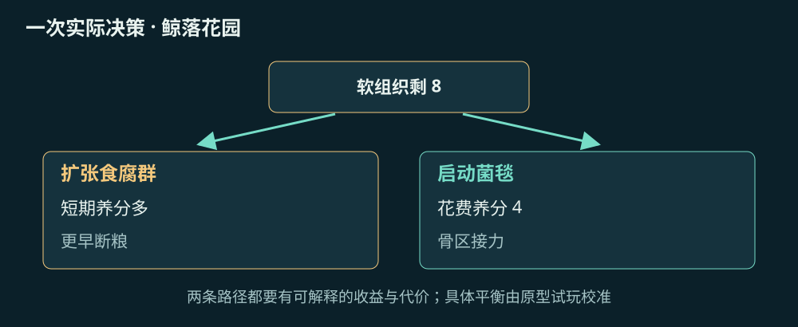

### 6. 核心循环与拼接

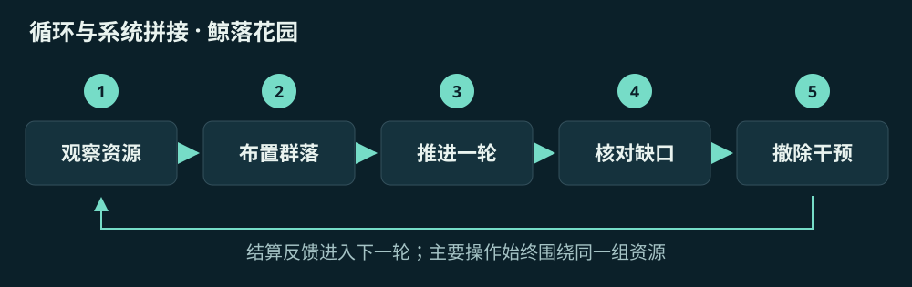

主玩法是空间资源规划；副玩法只保留关末拍照与图鉴，占体验约 15%。图鉴记录本关稳定共存条件，反过来帮助下一关规划。不要同时加入角色装备、自由潜航和基地建造。

### 7. 开发范围与验证

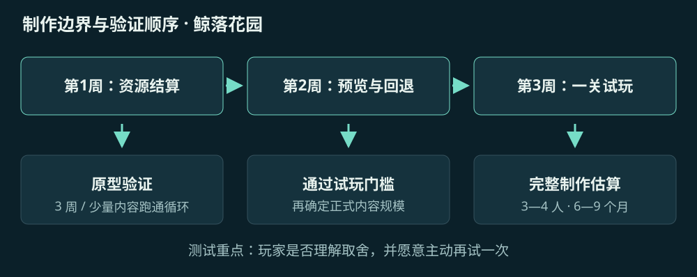

**最小可玩原型：** 1 张 8×8 地图、5 类群落、3 种资源、12 轮演替、1 个胜利目标；先用方块和图标做完整收支预览，再做场景生长表现。

**正式版上限：** 6 张地图、10 类群落、3 种环境事件、自由观赏模式；目标首通 3—5 小时，重玩来自生态布局。

**删减：** 删除完整食物网、个体级寻路、真实海水模拟与自由视角。生物按群落格结算，美术用同一骨架的 3 档覆盖层表现变化。

**风险：** 最大风险是生态运转不可读。原型阶段若玩家只能靠试错理解缺粮，先缩减到两条资源链，而不是增加物种。

**验证门槛：** 邀请 8 位目标玩家：至少 6 位能在第二局主动建立骨区接力，并说出断粮原因；这是内部立项门槛，不是行业基准。

### 8. 原作参考

[Terra Nil 官方商店](https://store.steampowered.com/app/1593030/)

借鉴 Terra Nil 的生态修复目标、分阶段变化与撤离收束；把主要决策改成鲸体有限养分的接力分配。

不复制其整套地貌改造工具；本案只制作一处鲸落及其周边。

图片版权归原作者。核对日期 2026-10-21。

## 02 骨海拼图

> 每一块鲸骨都是海底生命的一块拼图。

六角拼板 × 栖息地订单｜2—3 人｜原型 2 周｜完整制作 4—6 个月｜15—25 分钟 / 局

### 1. 体验定位与场景（场景分镜 1）

场景：由鲸骨构成的六角海床。

喜欢拼板、分数规划与轻松重玩的玩家

一张漂浮在深蓝背景上的海床六角棋盘。鲸头是起始地块，玩家沿脊椎拼出肋骨、泥地、菌毯和贝床；远看是一头鲸，近看是许多微型栖息地。

### 2. 操作与即时反馈（场景分镜 2）

操作：旋转接口，连接肋骨。

从三选一候选区拿取地块，滚轮旋转，放到已有地块旁。预览用实线标出连通骨缘，用轮廓显示可完成的生境订单；撤销限于下一次抽取前。

### 3. 关键取舍（场景分镜 3）

取舍：立即完成小区或延伸大链。

眼前地块能立刻封闭 3 格贝床拿到补牌，也能延长脊椎去接远端的高分骨区；后者需要两种尚未出现的接口。三选一降低纯运气，已知后续两轮的地块类型让玩家有规划依据。

### 4. 目标与成长回报（场景分镜 4）

回报：拼出可观赏的完整骨礁。

关卡模式：库存耗尽前完成 3 个生态订单；挑战模式：库存耗尽结算总分。没有时间压力，错误以空间被堵和机会成本体现。首次玩 5 分钟内就应完成一次补牌。

正式版提供 4 种鲸骨初始轮廓、18 类地块组合、12 类订单；局外解锁地图和外观，不叠加基础分数。额外模式只做每日固定种子，不做联机与复杂排行榜服务。

### 5. 可执行规则与决策

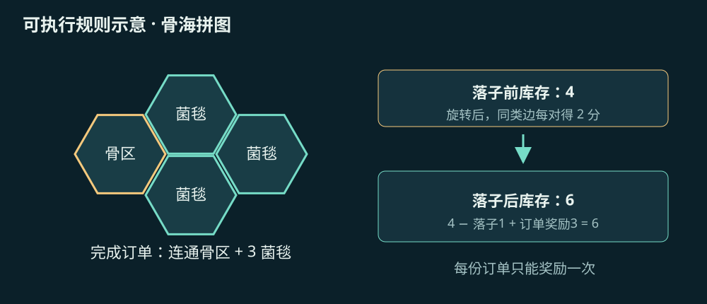

开局 18 块库存；每放置一块消耗 1。相邻同类边每对得 2 分；骨链必须接口相接。订单如“一个连通骨区旁接 3 块菌毯”，首次完成返 3 块库存。每份订单有唯一编号、最多奖励一次；新订单总量有限，避免无限补牌。

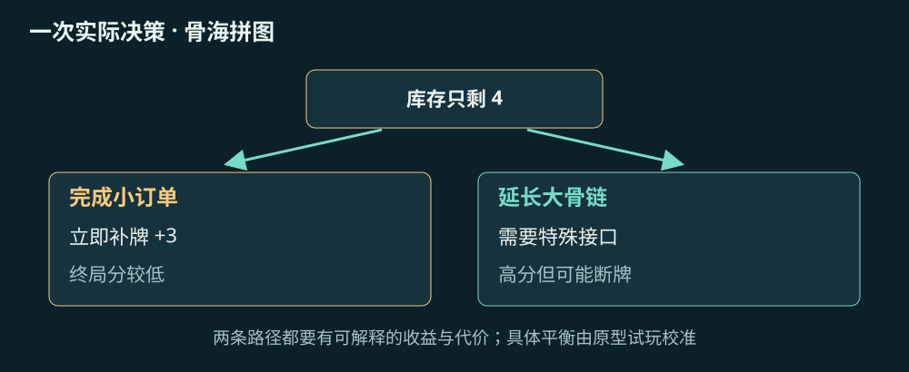

### 6. 核心循环与拼接

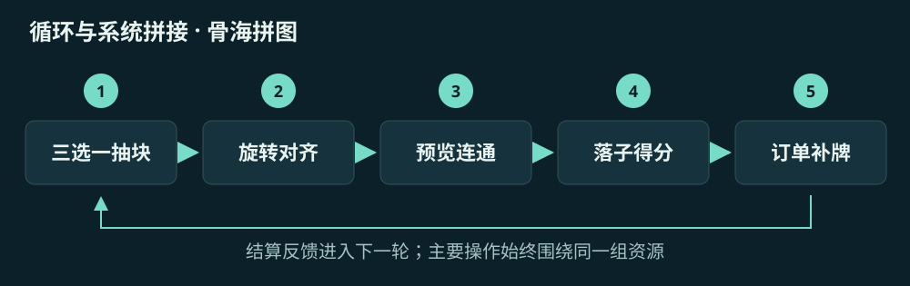

拼板占主要操作，订单为方向约束。可接入 01 的“生态前后对照”作为结算表现，但不引入持续资源消耗；否则轻松拼板会变成另一套模拟经营。

### 7. 开发范围与验证

**最小可玩原型：** 半径 4 的六角区域、6 种接口模板、6 个订单、连通检测与落子预览；不需要复杂模型即可测出玩法。

**正式版上限：** 4 张起始图、18 类地块、12 类订单、无尽计分与每日种子；目标关卡内容 2—4 小时，重玩主导。

**删减：** 删除自由地形编辑、地块上个体 AI、动态天气和关中生物养成。六角连接与奖励结算是唯一必须打磨的系统。

**风险：** 最大风险是拼得漂亮但决策重复。先验证三选一与骨链接口是否制造可解释的得失，再增加地块美术。

**验证门槛：** 8 位玩家中至少 6 位在首局完成订单；至少 5 位主动开第二局，并能指出一处想改善的布局。

### 8. 原作参考

[Dorfromantik 官方商店](https://store.steampowered.com/app/1455840/)

借鉴 Dorfromantik 的旋转拼板、连通区域与任务补充地块；新增鲸骨接口、固定遗骸轮廓和生态邻接目标。

不追求无限美术地形库；用有限鲸骨形状构成辨识度。

图片版权归原作者。核对日期 2026-10-21。

## 03 一鲸万生

> 把“死亡养活生命”做成能亲手叠出来的连锁反应。

叠卡生产 × 生态演替｜2—3 人｜原型 2 周｜完整制作 4—7 个月｜20—30 分钟 / 局

### 1. 体验定位与场景（场景分镜 1）

场景：鲸体卡逐渐变成生态卡。

喜欢配方发现、轻经营和卡牌组合的玩家

桌面中央是一组鲸体卡：肉、皮、骨、沉积物。四周逐渐出现蟹、菌、虫和贝的卡组；鲸体卡持续减少，生态卡持续增多，画面本身就能讲出鲸落。

### 2. 操作与即时反馈（场景分镜 2）

操作：物种与基质叠放生产。

拖拽物种卡叠到基质卡，查看配方和结算预览，点击潮汐结束本轮。配方首次发现后自动记入侧边图鉴；卡组可折叠，避免后期桌面被几十个计时器淹没。

### 3. 关键取舍（场景分镜 3）

取舍：短期兑换或长期菌群。

同一张骨卡可立即拆解换 3 营养，也可留给菌群连续生产。若所有骨卡都被兑换，前期扩张很快，后期将失去接替来源。让玩家自己发现“别把下一阶段吃光”，是本作的核心记忆点。

### 4. 目标与成长回报（场景分镜 4）

回报：建立跨阶段的稳定食物链。

在第 12 潮结束时拥有至少 4 类活跃物种，并完成 3 条接替链。连续两次维护后没有任何活跃物种则失败；允许回退上一潮。解锁配方靠条件与研究，不卖随机卡包。

正式版 36 张功能卡、24 条配方、3 个鲸落剧本；各剧本通过资源比例与事件顺序变化形成不同生态。通关解锁新起始牌组，不永久提高产量，保持决策压力。

### 5. 可执行规则与决策

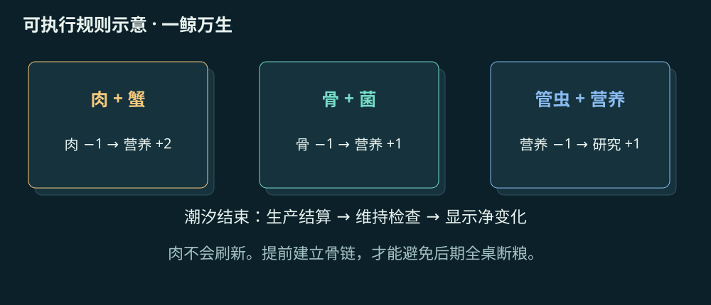

原型采用离散回合：蟹+肉，每轮消耗肉 1、产营养 2；骨+菌，消耗骨 1、产营养 1；管虫+营养，消耗营养 1、产研究 1。每两轮检查一次物种维持费用。肉有限且不刷新，骨链效率较低但持续更久。先结算生产，再支付维护，所有费用可预览。

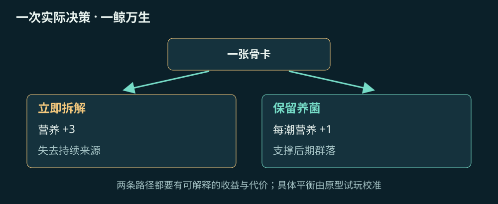

### 6. 核心循环与拼接

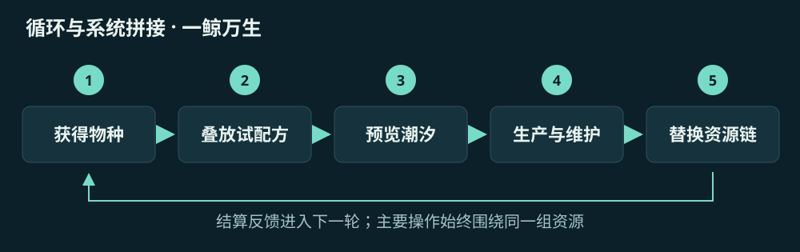

叠卡生产为主，图鉴收集为辅。可拼接 09 的鉴定任务作为少量新物种解锁条件，但每局最多一次，避免玩家频繁离开生产桌面。

### 7. 开发范围与验证

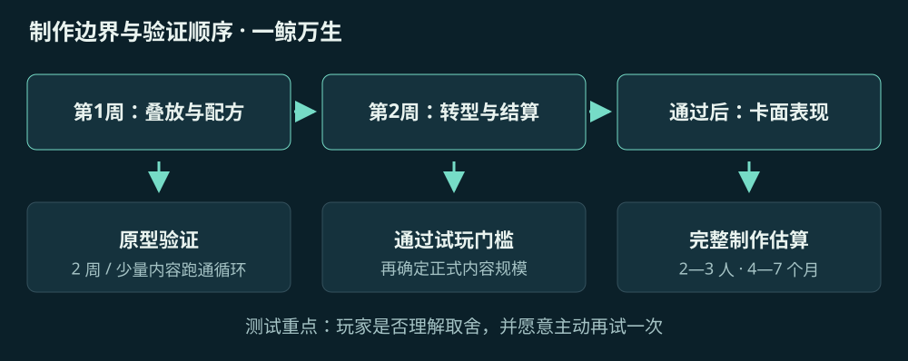

**最小可玩原型：** 12 张功能卡、8 条配方、12 个回合、一次肉到骨的转型；全流程控制在 15 分钟以内，先验证一次断粮与重新布局。

**正式版上限：** 36 张卡、24 配方、3 剧本、配方图鉴和固定种子挑战；目标 4—6 小时发现内容。

**删减：** 删除卡牌战斗、开放交易市场、实时多人和复杂实时计时。卡牌只保留 4 种核心字段：类别、库存、产出、维护。

**风险：** 最大风险是规则多、桌面乱。所有卡组必须显示本轮净产出；若玩家不理解维持费用，先改反馈与配方数量。

**验证门槛：** 8 位玩家中至少 6 位能不用提示完成一个新配方，至少 5 位在第二局主动保留骨储量；记录失败是信息不足还是策略判断。

### 8. 原作参考

[Stacklands 官方商店](https://store.steampowered.com/app/1948280/)

借鉴 Stacklands 用卡牌叠放表达生产关系的可读性；核心变化是不可再生鲸体与阶段性资源替代。

不照搬村民、房屋和战斗配方；本案的卡牌关系直接表达生态依赖。

图片版权归原作者。核对日期 2026-10-21。

## 04 最后一潜

> 巨鲸的肋骨后还有一个未知样本，而你的电量只够再犹豫一次。

短局潜航 × 样本撤离｜3—4 人｜原型 3 周｜完整制作 7—10 个月｜8—12 分钟 / 潜

### 1. 体验定位与场景（场景分镜 1）

场景：小潜艇与巨型肋骨的尺度对比。

喜欢探索、风险收益和轻度紧张感的玩家

2D 侧视海沟，一艘小型载人科研潜艇从左上补给站进入巨大鲸骨。照明只揭示局部空间，声呐提前提示通道与移动物；同一遗骸分头骨、胸腔和尾部三个深度区。

### 2. 操作与即时反馈（场景分镜 2）

操作：进入缝隙，停船采样。

WASD 驾驶、鼠标定向灯、按键抓取样本和释放声呐。停船采样需要 4 秒；移动与扫描消耗电量。回收舱是简单格位货舱，整理仅发生在安全区，避免与操控争抢注意力。

### 3. 关键取舍（场景分镜 3）

取舍：返航余量与未知收获。

电量剩 30，安全返程预计要 22；继续采一份标本要 4 秒，再加绕行约 8 电，已经超支。玩家可扔掉重物启用应急滑行，代价是损失样本；风险应来自可见的路线与消耗，不靠突然刷怪。

### 4. 目标与成长回报（场景分镜 4）

回报：保全标本并改装下一潜。

带指定样本回到补给站完成委托。电量耗尽触发救援，失去未保全的本次货物，但已扫描图鉴保留；主要惩罚是本次收益，不倒扣多轮积累。

6 个小型潜点重复利用 3 套鲸骨模块；升级灯、货舱与声呐改变可达路线。最终委托要求留下生态观察设备而不是搜刮整片遗骸，形成主题收束。

### 5. 可执行规则与决策

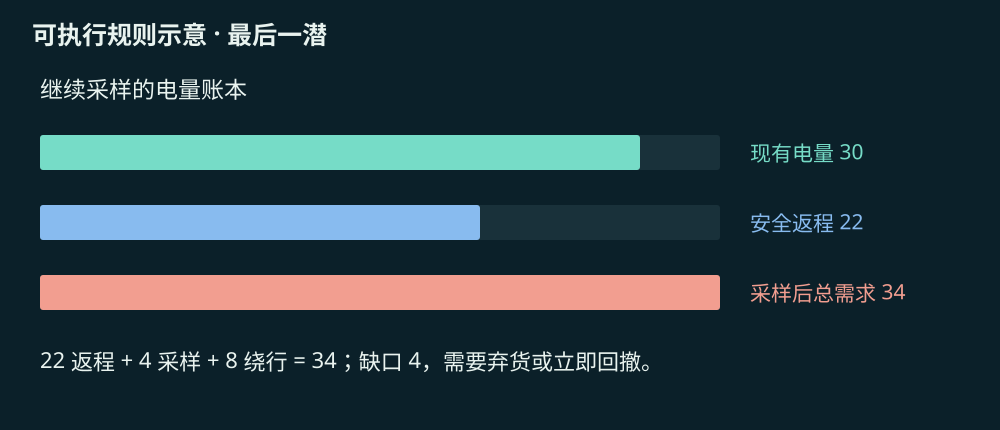

原型电量 100，普通移动每秒耗 1，声呐每次耗 6；返程预计消耗由路径长度和流速计算并显示区间。样本占 1—3 格，共 8 格货舱。过度采样使该区域下次访问出现短缺并减少常见样本，保护行为则解锁罕见观察记录。

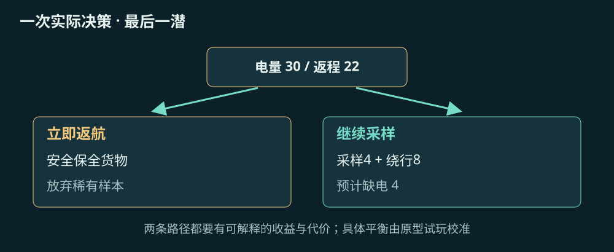

### 6. 核心循环与拼接

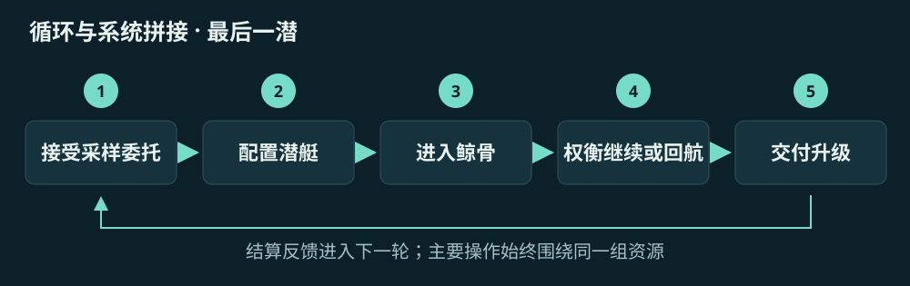

潜航探索约占 75%，港口配装与样本陈列约占 25%。借用 10 的少量收纳格位作为载重决策即可，不再做完整经营商店或开放海洋航行。

### 7. 开发范围与验证

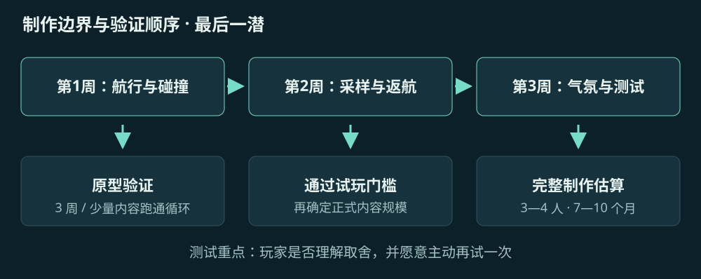

**最小可玩原型：** 1 个可循环潜点、3 种样本、2 种障碍、1 种移动威胁、货舱与返程估算；优先验证操控手感和紧张区间。

**正式版上限：** 6 潜点、24 样本、9 模块、12 委托；目标 4—6 小时流程。

**删减：** 删除无缝大海、自由 3D 游泳、船体物理破坏和复杂敌人战斗。碰撞与水流用可控的二维速度场。

**风险：** 最大风险是潜艇操控迟钝、返程重复。提供已探索路线的加速通行与可信电耗提示；不以提高惩罚掩盖无聊路程。

**验证门槛：** 8 位玩家中至少 6 位能读懂返航余量；首潜主动回撤与贪采都应出现，并能解释选择原因。若全员机械等低电报警，风险收益设计不成立。

### 8. 原作参考

[DREDGE 官方商店](https://store.steampowered.com/app/1562430/)

借鉴 DREDGE 的出航、收集、回港升级与风险氛围节奏；改为围绕单处鲸落的二维潜航和克制采样。

不复制群岛体量、完整钓鱼系统或长线任务网。

图片版权归原作者。核对日期 2026-10-21。

## 05 守骨者

> 白潮采集，暗潮守护，在鲸的胸腔里保住一窝新生命。

采集搬运 × 波次防守｜3—4 人｜原型 3 周｜完整制作 6—9 个月｜18—25 分钟 / 局

### 1. 体验定位与场景（场景分镜 1）

场景：肋骨天然构成三处防御槽。

喜欢短局守点、压力管理与即时操作的玩家

侧视鲸骨避难所。头骨附近有材料，肋骨形成三个防守槽，右侧水流带来捕食者。玩家控制一只背着工具的寄居蟹，在运输路线与炮台之间来回切换。

### 2. 操作与即时反馈（场景分镜 2）

操作：采集后带着材料回巢。

移动、采集、拾取、回巢入库；敌潮到来时接管喷流器瞄准击退。自动海葵负责减速，玩家负责方向与优先目标，让有限防御槽比堆满塔更重要。

### 3. 关键取舍（场景分镜 3）

取舍：手动接管最危险的一路。

距离暗潮剩 15 秒，深处有高价值材料，但满载返程要 18 秒。可丢下一格材料轻装返回，也可让巢先承受一次攻击以换升级。默认捕食者只是生态压力，不塑造成邪恶；以驱离和遮蔽为主要防守表达。

### 4. 目标与成长回报（场景分镜 4）

回报：存活幼体与升级选择。

守过第 5 潮并释放幼体即胜利；巢完整度归零失败。击退数不是唯一目标，可通过诱饵把捕食者引离路线。结算比较存活幼体与剩余栖息地。

2 套可操作防御器、6 种辅助器官、4 类来袭行为、3 种骨架地形；局外仅解锁起始配置，局内升级形成不同运输与防守节奏。

### 5. 可执行规则与决策

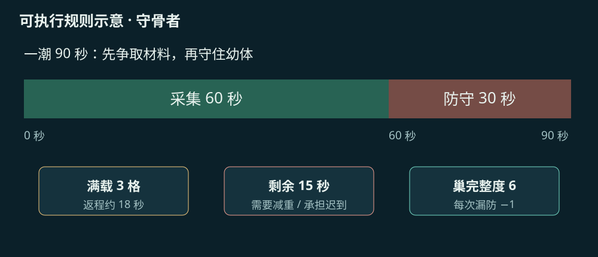

每轮 60 秒采集、30 秒防守，共 5 潮。起始背包 3 格，走一趟需约 18 秒；材料用于修复、扩容或安置海葵。幼体巢有 6 点完整度，穿透的捕食者每次造成 1 点损失。每潮显示来袭方向和类型。

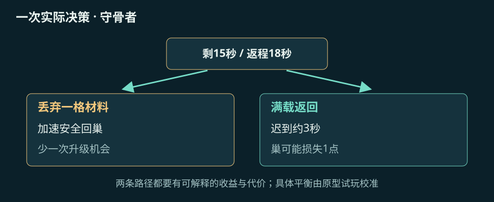

### 6. 核心循环与拼接

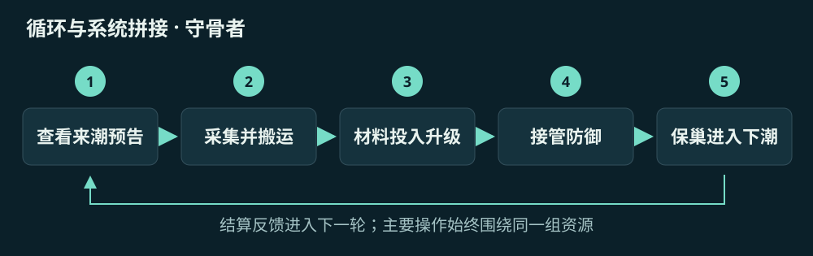

资源搬运与操作防守共用“时间与材料”两种稀缺资源，互相制造取舍。没有必要再加入地牢、独立肉鸽卡组或多人合作。

### 7. 开发范围与验证

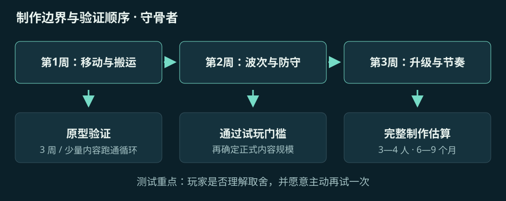

**最小可玩原型：** 1 张固定地图、1 种主防御器、2 种敌人、3 次波次、3 个升级，测试单局 10 分钟即可。

**正式版上限：** 3 种地图、2 防御器、6 辅助器官、4 类敌人、5 潮局；以短局重玩为主。

**删减：** 删除可破坏地形、数十种武器和复杂技能树。采集点用槽位库存表现，敌人走明确通道。

**风险：** 最大风险是搬运与守点割裂。若回防像强制打断，应缩短路径，或让运输路线中的诱饵也参与防守。

**验证门槛：** 8 位玩家中至少 6 位能在第二潮前主动返回；观察玩家是否至少一次为速度丢弃资源，验证运输权衡成立。

### 8. 原作参考

[Dome Keeper 官方商店](https://store.steampowered.com/app/1637320/)

借鉴 Dome Keeper 的采集窗口、回防压力与升级取舍；改造为鲸骨空间中的幼体守护和生态驱离。

不照搬挖矿深度与大量地块破坏；核心是往返时机。

图片版权归原作者。核对日期 2026-10-21。

## 06 潮汐棋局

> 你不能消灭所有捕食者，但可以让这一潮的新生命安全通过。

意图预告战棋 × 生态护送｜3 人｜原型 3 周｜完整制作 6—8 个月｜5—8 分钟 / 战斗

### 1. 体验定位与场景（场景分镜 1）

场景：紧凑骨区棋盘与卵群。

喜欢信息透明、位移连锁与短关解题的策略玩家

6×6 格的鲸骨战场，骨柱是阻挡，卵群是保护目标，水流每两回合推进一次。玩家的蟹、海星和喷流生物具有明显不同的轮廓与功能。

### 2. 操作与即时反馈（场景分镜 2）

信息：攻击方向在行动前公开。

先看敌人下一步的攻击线，再给三个单位各安排一次移动与一次技能；确认结束回合。蟹推一格、海星牵引一格、喷流改变一条流向，攻击伤害作为次要工具。

### 3. 关键取舍（场景分镜 3）

操作：横推改变攻击落点。

红色攻击线指向卵群。直接攻击只能削弱捕食者，仍阻止不了本轮袭击；把它横推一格可让攻击落空，再借水流带走卵群。玩家需要解决局面，而非按最高伤害按钮。

### 4. 目标与成长回报（场景分镜 4）

回报：护送成功，而非消灭一切。

护送至少 2 组卵群到出口，或守住 4 回合完成迁移。失去全部卵群则失败，损失一只友方单位仍可继续；评价只使用明确的保全目标。

正式版先做 3 个固定友方单位、6 种敌意图、18 个手工关卡；通关解锁技能侧向替换。随机战役留待基础关卡证明可重复解题后再考虑。

### 5. 可执行规则与决策

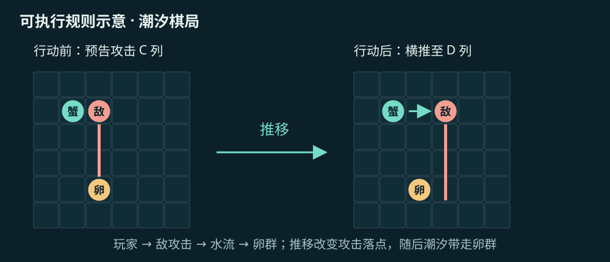

敌意图在玩家行动前公开。回合顺序固定为玩家行动→敌攻击→水流位移→卵群迁移；预览显示完整结果。单位不能叠格；被推向占用格则停住。骨柱不可破坏，减少边界组合。每回合允许一次全队重置。

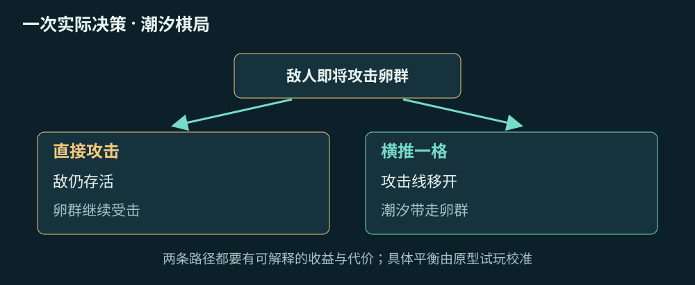

### 6. 核心循环与拼接

战棋与生态护送共享棋盘和回合。可把 02 的骨块作为少量战前布置选择，但不能再接完整城市建设，避免每局开始前准备过长。

### 7. 开发范围与验证

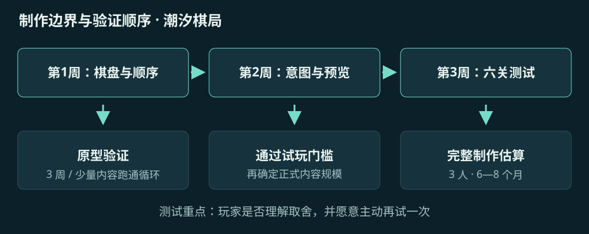

**最小可玩原型：** 6×6 棋盘、3 个我方单位、2 个敌人行为、6 个教学关，做完意图预览与重置才加内容。

**正式版上限：** 18 手工关、3 角色、6 敌意图、6 技能侧向替换；目标 3—5 小时解题。

**删减：** 删除随机装备、命中率、复杂状态叠加和大量角色。预告与实际结算必须一致。

**风险：** 最大风险是组合规则与预览不一致。先锁定回合顺序，用少量典型局面验证阻挡、推拉和潮汐边界。

**验证门槛：** 8 位玩家中至少 6 位在第三关前用位移保护目标；一次回合结果不能出现未预告的重要损失。

### 8. 原作参考

[Into the Breach 官方商店](https://store.steampowered.com/app/590380/)

借鉴 Into the Breach 的公开敌意图与保护目标的回合策略；让潮汐位移和非歼灭迁移构成独立主题机制。

不制作机甲式武器库与长战役地图；优先保证六格棋盘上的解题质量。

图片版权归原作者。核对日期 2026-10-21。

## 07 深海脉络

> 鲸落是最后一座供给站，你要把它的馈赠送到每个角落。

路径规划 × 供需调度｜2—3 人｜原型 2 周｜完整制作 4—6 个月｜12—20 分钟 / 局

### 1. 体验定位与场景（场景分镜 1）

场景：鲸骨周围的供需节点。

喜欢极简调度、路线优化与持续反馈的玩家

俯视海床以鲸骨作背景，圆形资源源点、三角幼体群、方形菌床分布其上。彩色流线输送养分颗粒；资源耗尽后源点从鲸肉区迁往骨区，整张网络需要重画。

### 2. 操作与即时反馈（场景分镜 2）

操作：画线并分配运力。

鼠标拖线连接节点，拖动节点间的弧线改变路径，分配有限运输群。可以暂停规划，恢复后观察队列；点击拥堵节点显示需求与预计送达时间。

### 3. 关键取舍（场景分镜 3）

取舍：拥堵位置与空闲支路。

中心节点排队 5 颗，一条长环线覆盖了很多栖息地，却来不及回访。把环线拆为两条短线能缓解拥堵，但会占用最后一个线路名额，稍后骨区新源点出现时缺乏余量。

### 4. 目标与成长回报（场景分镜 4）

回报：资源换区后重建高效网络。

关卡模式维持网络 6 分钟并完成一次源点接替；两处群落衰弱倒计时结束即失败。运输不是凭空增加营养：总量受鲸体储量限制，关末保留种群越多评价越好。

8 个节点布局、3 种流速地形、源点提前耗尽等少量事件；逐关增加网络结构难度。生物贴图只作为节点外观，不运行个体觅食模拟。

### 5. 可执行规则与决策

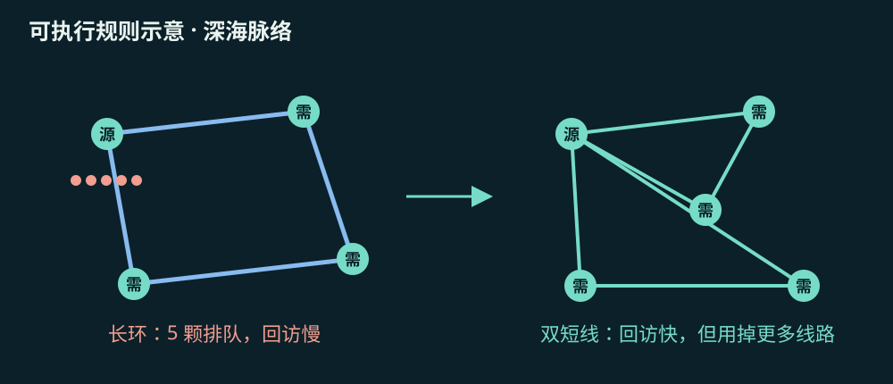

原型最多 3 条线路、每线 1 个运输群，每群载 3 颗养分；一段标准边行驶 4 秒。需求每 12 秒增加 1，排队超过 6 时启动 20 秒衰弱计时。计时期间解除拥堵即可恢复。每 60 秒给一个升级，容量或新线二选一。

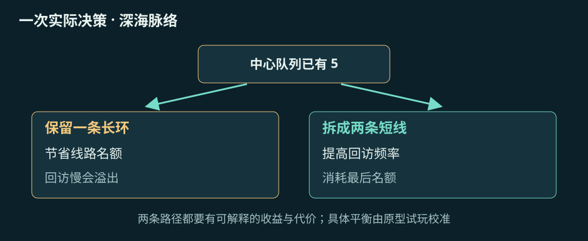

### 6. 核心循环与拼接

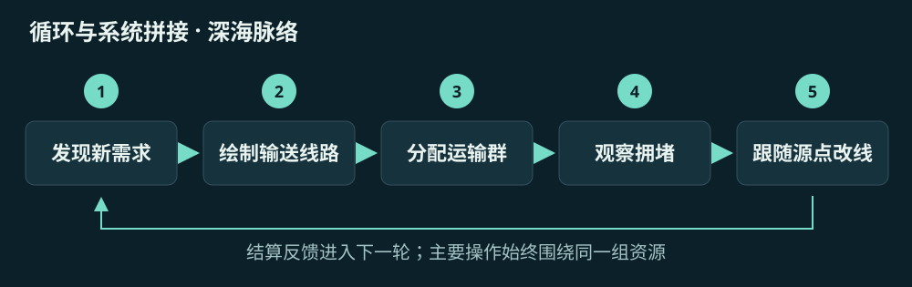

路径规划为主，生态阶段更换提供中局重构。可加 01 的群落复苏外观，但不再增加物种合成、装备和建筑树。

### 7. 开发范围与验证

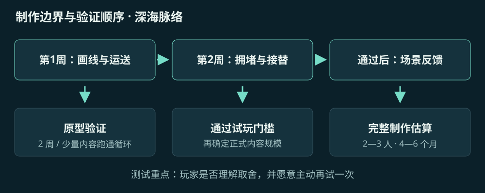

**最小可玩原型：** 6 个节点、2 类形状、3 条线路、1 次源点切换、队列与送达预测；用图形即可测试。

**正式版上限：** 8 布局、3 流速条件、关卡与固定种子挑战；以 2—3 小时关卡和重复挑战构成内容。

**删减：** 删除复杂洋流流体、海洋真实地理、随机灾害大表与全球生态模拟。线路速度只受边长和固定修正影响。

**风险：** 最大风险是看起来像换皮线路游戏。必须在原型里做出“源点因鲸体演替而迁移”的重构高潮，并给予足够预告。

**验证门槛：** 8 位玩家中至少 6 位理解容量与回访频率区别；至少 5 位能在源点切换前预留路线，而非只能事后补救。

### 8. 原作参考

[Mini Metro 官方商店](https://store.steampowered.com/app/287980/)

借鉴 Mini Metro 的画线、有限运力与拥堵反馈；本案将固定供给源的消耗与迁移做成中局结构变化。

不把每一条营养路径都升级为物理模拟，保持图论规则可读。

图片版权归原作者。核对日期 2026-10-21。

## 08 鲸骨里的百年

> 你操纵的不是一个角色的力量，而是一头鲸离开后的一百年。

时间切换 × 环境解谜｜2—3 人｜原型 3 周｜完整制作 5—8 个月｜5—10 分钟 / 谜题

### 1. 体验定位与场景（场景分镜 1）

场景：巨大骨腔中的微小生命。

喜欢安静解谜、环境叙事和视觉变化的玩家

固定侧视的鲸骨小舞台，玩家帮助一只发光幼体抵达下一片安全区。同一场景在软组织期、露骨期和生境期有三套可辨认的形态；画面变化直接改变通路。

### 2. 操作与即时反馈（场景分镜 2）

早期：肉壁是阻挡也是平台。

左右移动幼体，点击三个时间刻度切换阶段，拖动一个可保留位置的“记忆壳”作为支撑。切换前以虚影显示即将消失的平台，玩家可随时回到先前阶段。

### 3. 关键取舍（场景分镜 3）

中期：腐解打开通路，骨桥改变。

早期肉壁挡路，中期腐解开洞但肋骨坍落，晚期管虫冠形成落脚点。正确顺序是先放壳支撑骨桥，再切中期穿洞，最后切晚期借管虫到终点；仅不断快进无法通过。

### 4. 目标与成长回报（场景分镜 4）

晚期：新生群落成为最后落脚点。

把幼体送入出口，收集可选的第二个生命种子形成挑战。没有死亡次数与限时；失败即局部回退，重点在理解因果。

18 个手工谜题，按“阶段差异→跨时保留→组合因果”三章推进，每章只加一条规则。叙事用同一块鲸骨上出现的新生命表达，不依赖大量对白与过场。

### 5. 可执行规则与决策

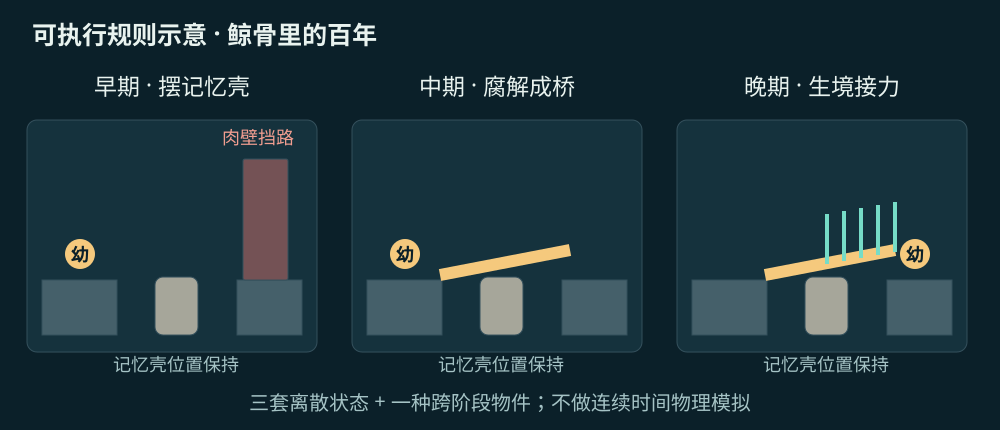

不模拟连续百年；每关只有 3 个离散状态。普通地形由阶段决定，记忆壳的位置跨阶段保留；幼体若被新地形覆盖，自动退回最近安全点并提示。没有跳跃精度考验，移动与落点吸附在关键台阶。

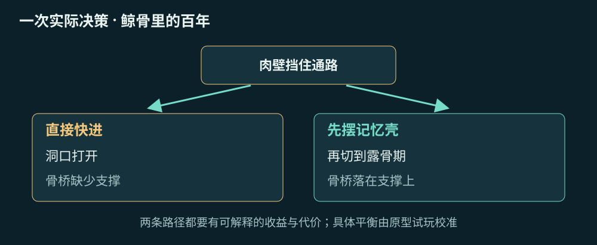

### 6. 核心循环与拼接

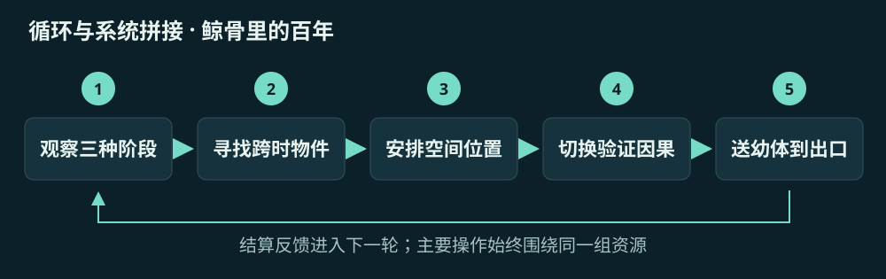

环境解谜与时间切换本身共用一个场景；可接 09 的简短观察条目作章节奖励，不接经营数值，保持 2—3 小时短篇体量。

### 7. 开发范围与验证

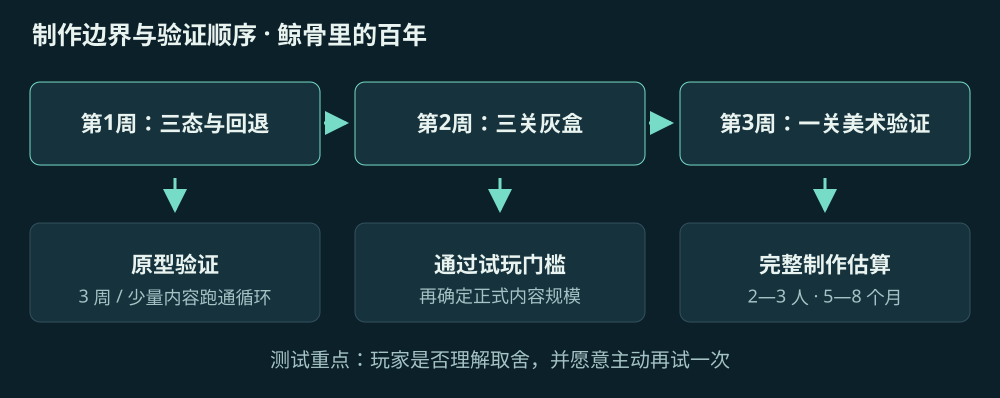

**最小可玩原型：** 3 个完整谜题、3 个阶段、1 种跨时物件；必须先用灰盒证明关卡有唯一可解释的主要因果。

**正式版上限：** 18 谜题、3 章、2 种跨时物件、可选种子；目标 2—3 小时首通。

**删减：** 删除连续时间物理、复杂物品栏、人物战斗与自由镜头。阶段切换用状态快照，关卡手工制作。

**风险：** 最大风险是每关都要三倍美术且解法牵强。复用骨架底图、替换局部层；先量测一关从灰盒到成品所需时间再承诺关卡数。

**验证门槛：** 8 位玩家中至少 6 位能在不读攻略情况下解开前两关；过关后能复述“先放壳再变时间”的原因，而非靠穷举偶然通过。

### 8. 原作参考

[The Gardens Between 官方商店](https://store.steampowered.com/app/600990/)

借鉴 The Gardens Between 通过操控时间解谜的方向；改为鲸落阶段切换与跨阶段保留的空间道具。

不借用原作人物、物件与关卡解法，避免依赖过高的镜头叙事成本。

图片版权归原作者。核对日期 2026-10-21。

## 09 深渊标本室

> 每一个无名标本，都在讲述这头鲸如何成为另一个世界。

观察鉴定 × 轻叙事推理｜2—3 人｜原型 2 周｜完整制作 4—6 个月｜10—15 分钟 / 案例

### 1. 体验定位与场景（场景分镜 1）

场景：标本、手册与鲸骨舷窗。

喜欢翻阅手册、观察细节和安静推理的玩家

海底站的一张工作台：样本盘、放大镜、记录簿、来源地图和食物关系板。舷窗外是逐步变化的鲸骨；玩家不自由潜水，而是通过样本重建海床发生的事。

### 2. 操作与即时反馈（场景分镜 2）

操作：放大观察冠部结构。

旋转二维标本或切换观察面，检查冠部、附着基质和采样深度；在手册中圈出特征，将证据卡拖到候选物种下，提交鉴定与生态位置。

### 3. 关键取舍（场景分镜 3）

推理：外观、基质、来源交叉排除。

红色冠部同时符合 A 与 B；A 依赖岩面，B 依赖富有机质的骨区。样本附着的白色碎片和来源记录构成第二证据。玩家应学会交叉验证，而不是记住颜色=答案。

### 4. 目标与成长回报（场景分镜 4）

回报：为生态关系补上一个节点。

正确鉴定并将标本接入关系板，完成本例。累计三次错误进入辅助复核，仍可推进故事但失去该例的独立研究标记；不锁死整局。

24 种虚构或经核验的物种、12 个案例、3 个章节。后期案例调查“为何这一片群落消失”，复用已知物种与新的来源关系，降低纯新增绘画量。真实知识与艺术设定在图鉴中明确区分。

### 5. 可执行规则与决策

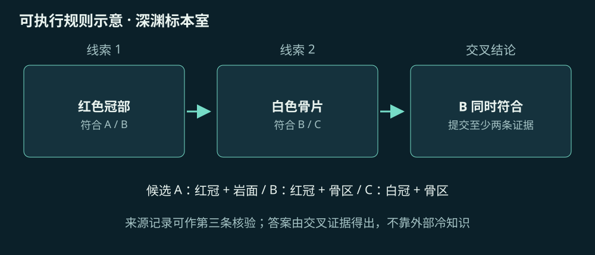

每例提供至少 3 条可见线索，至少 2 条独立证据才能提交。候选共享部分外观，但不会出现完全不可区分的正确答案。错误提交消耗一次复核机会，系统只指出冲突证据，不直接报答案；无时间限制。

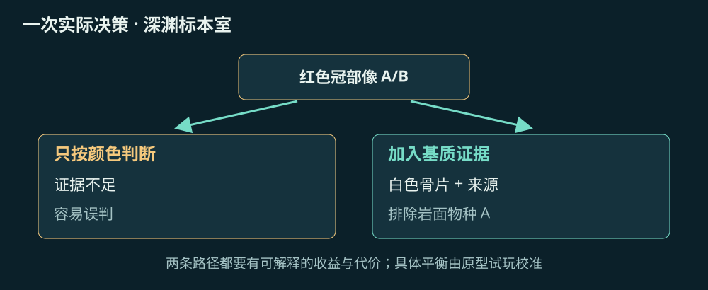

### 6. 核心循环与拼接

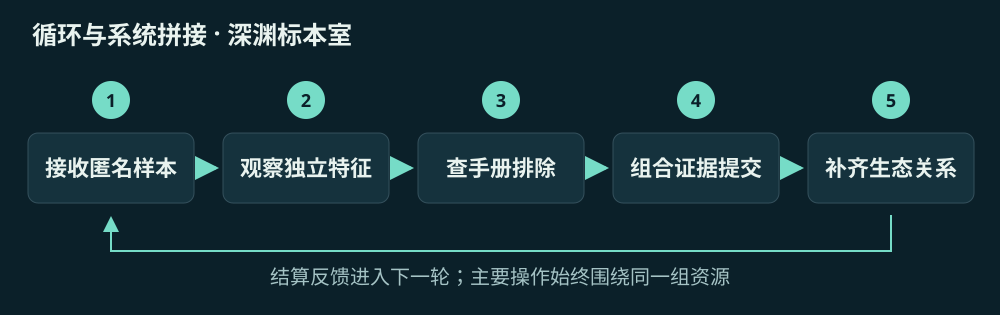

鉴定为主，食物关系拼图为辅；鉴定结果给关系板提供节点，关系板反过来指向下一份委托，两个玩法共享证据卡。可与 03 结合，但单独产品更易控制节奏。

### 7. 开发范围与验证

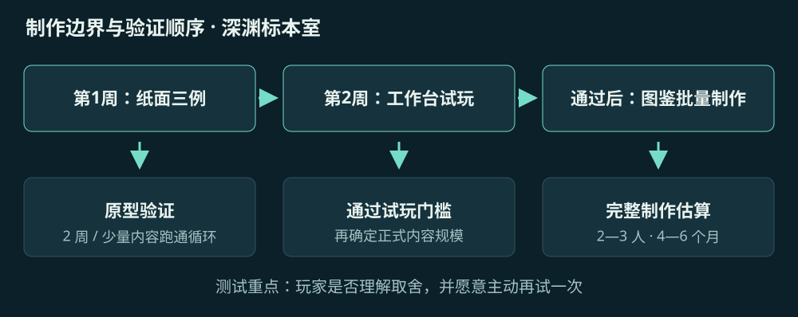

**最小可玩原型：** 6 种物种、3 个案例、2 种观察工具、手册检索和证据提交；所有线索先在纸上完成逻辑校验。

**正式版上限：** 24 物种、12 案例、3 章节、一本完整图鉴；目标 3—4 小时内容。

**删减：** 删除自由探索大地图、全角色配音、程序生成谜案和大量分支结局。结局只由两次明确研究选择改变。

**风险：** 最大风险是谜题靠冷知识或文案歧义。关键证据必须出现在游戏内，图案与文字双重表达；真实海洋物种另做资料核验。

**验证门槛：** 8 位玩家中至少 6 位能以两条独立证据完成第三例；对每次误判记录其引用线索，若集中误读同一句话，先修改表达。

### 8. 原作参考

[Strange Horticulture 官方商店](https://store.steampowered.com/app/1574580/)

借鉴 Strange Horticulture 的观察对象、查图鉴、用识别结果推进事件；转化为鲸落物种与生态关系推理。

不复制其植物外形与故事设定，不把知识问答当作推理。

图片版权归原作者。核对日期 2026-10-21。

## 10 给新生命一个家

> 在鲸留下的空隙里，为每一种新生命找到合适的位置。

空间收纳 × 微型生境布置｜2—3 人｜原型 2 周｜完整制作 4—6 个月｜8—15 分钟 / 场景

### 1. 体验定位与场景（场景分镜 1）

场景：像微型房间一样的鲸骨空隙。

喜欢收纳、装饰和轻度空间解题的玩家

鲸胸腔像一间没有屋顶的微型房屋，肋骨是隔断，贝壳是家具，水流是走道。每章收到一箱新生境模块，摆放完成后镜头拉远，显现独一无二的骨礁小家。

### 2. 操作与即时反馈（场景分镜 2）

操作：旋转庇护所找到合适占地。

拖动并旋转 L 形庇护所、2 格菌床和 1 格生物巢；悬停显示占地、流道与邻接条件。玩家可以随时拿起重摆，拍照模式只在完成后解锁。

### 3. 关键取舍（场景分镜 3）

取舍：遮蔽、安全与水流互相影响。

将大庇护所放中央能立刻装下全部幼体，却会截断两块滤食模块的水道；旋转后沿肋骨摆放占用更多边缘格，但保留贯通水流。没有唯一标准摆法，约束应允许多个好看解。

### 4. 目标与成长回报（场景分镜 4）

回报：完成可拍照的新生命之家。

所有必需模块落位且硬约束满足即可完成；没有计时和扣分。错误模块以条件图标提示，玩家自行调整；可选目标是保留一条观赏通廊。

12 个房间式鲸骨场景、30 件可复用模块、4 组环境主题。每章保留一个旧物，如一枚被不同生物继承的贝壳，通过摆放位置讲述时间流逝。

### 5. 可执行规则与决策

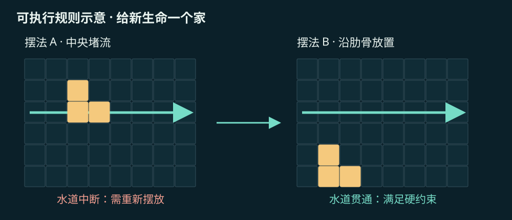

原型是固定 6×8 可用格；硬约束只有不重叠、不封死主水道、每个物种满足 1 个生境条件。软目标为颜色与观察视角，不影响通关。管虫要邻接菌床，幼体巢须至少一侧有遮蔽，滤食模块须朝向水道。均为美术化规则。

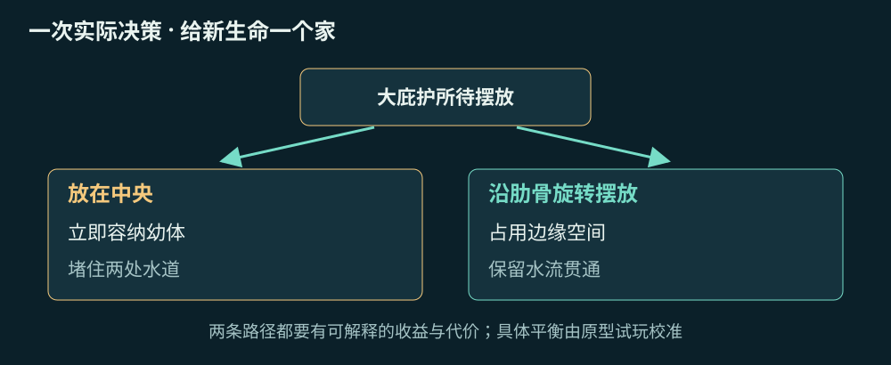

### 6. 核心循环与拼接

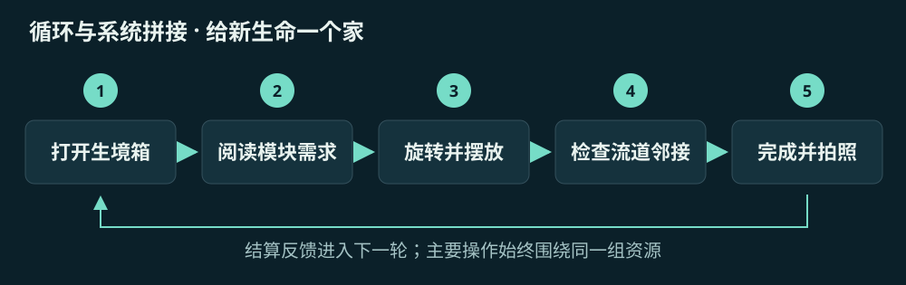

收纳解题为主、环境叙事为辅。不要加入饥饿衰减；否则舒适布置会变为必须维护的负担。可以借 08 的三个时期作章节背景，但不做随时切换。

### 7. 开发范围与验证

**最小可玩原型：** 1 个 6×8 场景、8 件模块、3 类约束、抓取旋转与问题高亮；用 3 种不同完整解验证自由度。

**正式版上限：** 12 场景、30 模块、4 主题、拍照导出；目标 2—3 小时关卡加自由布置。

**删减：** 删除自由建模、真实流体、繁殖 AI、无穷家具库。装饰差异通过换色和局部纹理表达。

**风险：** 最大风险是变成猜策划标准答案。每关制作至少 3 种合法布局；反馈具体指出“缺水流”或“未邻接菌床”，不只画红框。

**验证门槛：** 8 位玩家至少产生 3 种不同合法布局，至少 5 位愿意在通关后继续调整构图；若都照同一解摆完离开，需提高摆放自由。

### 8. 原作参考

[Unpacking 官方商店](https://store.steampowered.com/app/1135690/)

借鉴 Unpacking 的拖放收纳、空间满足感和物件叙事；用生境相邻与水流通达替代日用品归位。

不复制房间与个人生活叙事，鲸骨本身就是独特的空间结构。

图片版权归原作者。核对日期 2026-10-21。

## 11 骨脉工坊

> 这不是一座无限工厂，而是一场把有限鲸骨变成生命种子的接力。

有限资源自动化 × 生产解谜｜2—3 人｜原型 3 周｜完整制作 5—7 个月｜15—25 分钟 / 关

### 1. 体验定位与场景（场景分镜 1）

场景：鲸骨范围内的生物产线。

喜欢生产线、吞吐优化与可视化规则的玩家

俯视固定网格，鲸骨是有限输入源，菌床是反应模块，生物管道输送颗粒，出口是待播撒的生命囊。产线在骨架内转弯，既像微型工厂也像生物循环。

### 2. 操作与即时反馈（场景分镜 2）

操作：连接转化、分流与培养。

拖放提取、转化、分流、培养模块并旋转端口；连管后运行、暂停、单步查看。点击节点看到每秒输入、输出和库存，所有堵塞直接显示在管线上。

### 3. 关键取舍（场景分镜 3）

取舍：堵塞来自出口而非机器少。

菌床理论每秒产营养 1.5，但单出口管只能送 1；再放一个菌床不会解决堵塞，反而提前耗光原料。正确做法是分流到两条管，再决定是否增加培养器。核心是读懂瓶颈而非堆建筑。

### 4. 目标与成长回报（场景分镜 4）

回报：恰好完成有限生命囊订单。

骨质耗尽前交付 8 个生命囊且不遗留超标废料即可过关。挑战目标是少管线或少消耗，分别显示，不混成难以理解的总评分。

12 个手工生产谜题、6 类模块、3 种资源配方；后期增加不同形状输入口和副产物回收。固定棋盘避免无限地图和无限性能优化的开发负担。

### 5. 可执行规则与决策

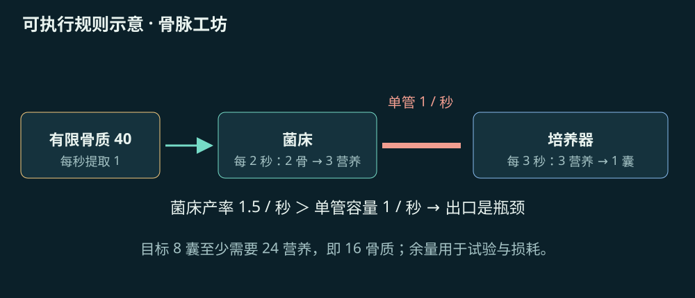

每关骨质预算 40。提取器每秒处理骨质 1，菌床每 2 秒将骨质 2 转为营养 3，培养器每 3 秒消耗营养 3 生成生命囊 1。管道每秒最多传 1 颗；分流器左右轮流送。拆除设施退回建造材料，已转化的骨质不退回；可整关重置。

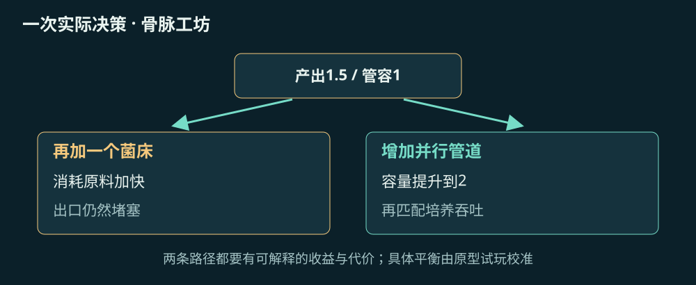

### 6. 核心循环与拼接

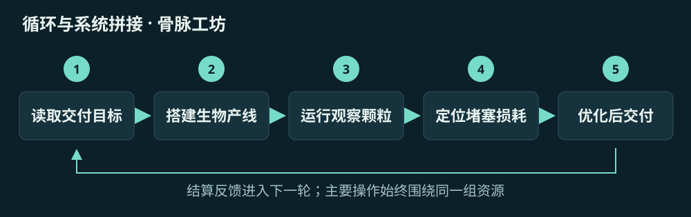

自动化和有限预算关卡共用产线；可使用 03 的配方发现作为前两关教学，其后全部配方公开，不做隐藏解锁阻断优化。

### 7. 开发范围与验证

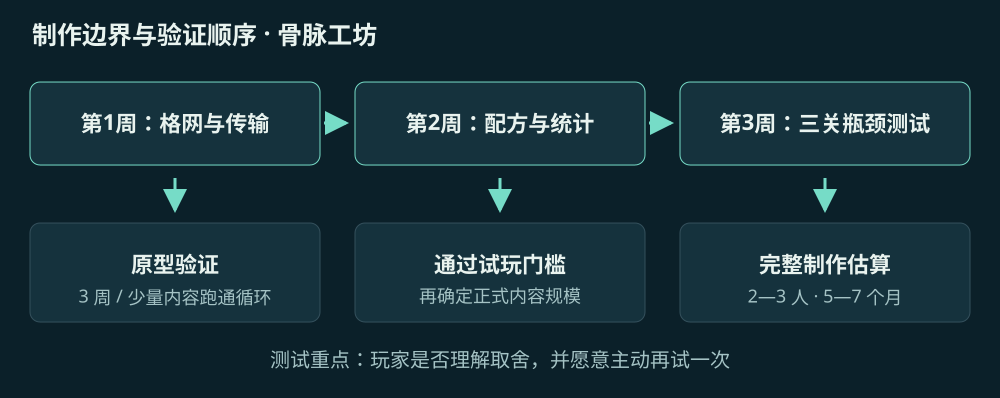

**最小可玩原型：** 10×10 棋盘、4 模块、1 配方链、3 关；先完成确定性步进与吞吐统计，再做粒子表现。

**正式版上限：** 12 关、6 模块、3 配方、两个独立挑战指标；目标 3—5 小时解题。

**删减：** 删除无限地图、电路编程、百种配方和复杂物流寻路。管线采用有向格链与固定时间步进。

**风险：** 最大风险是主题只剩贴图。关卡必须体现原料有限、阶段性来源变化和最后主动停机，让效率服务于生命产出。

**验证门槛：** 8 位玩家中至少 6 位在第三关能用吞吐信息指出真实瓶颈；若多数只靠堆模块过关，调整预算与出口约束。

### 8. 原作参考

[shapez 官方商店](https://store.steampowered.com/app/1318690/)

借鉴 shapez 的可视化加工、连接产线与吞吐优化；将无限扩张改为鲸骨预算下的有限关卡。

不做无限地图工业沙盒，不复制其图形切割配方。

图片版权归原作者。核对日期 2026-10-21。

## 12 最后一座骨城

> 你知道这座城终会失去养分，任务是让它的居民有机会离开。

微型聚落 × 迁徙决策｜4 人｜原型 4 周｜完整制作 8—12 个月｜40—60 分钟 / 剧本

### 1. 体验定位与场景（场景分镜 1）

场景：肋骨之间的甲壳居民聚落。

喜欢群落管理、资源转型和生存叙事的玩家

固定斜俯视鲸骨，一小群拟人甲壳居民在肋骨间搭建贝壳居所。鲸体不移动，世界变化来自食物逐渐耗尽、菌群兴起和最后的迁徙潮窗。

### 2. 操作与即时反馈（场景分镜 2）

操作：在四类岗位之间分配劳力。

分配居民到采食、菌培、育幼和迁徙准备四类岗位，选择有限建筑槽并查看下一日食物收支。居民数量按小组统计，画面中的走动只作表现。

### 3. 关键取舍（场景分镜 3）

取舍：耗尽前扩张还是提前转型。

增加采食岗位可以迅速繁荣，却加速消耗软组织；过早让两人投入菌培又会造成当日收支紧张。玩家需要选择何时停止扩张、转入低产稳定供给，并为离开存下资源。

### 4. 目标与成长回报（场景分镜 4）

回报：迁徙离开，旧址回归生态。

第 10—12 天间让至少 6 名居民完成迁徙即胜利；居民归零或错过迁徙窗失败。离开后原址成为无人干预的生态群落，结算强调留下了什么和带走了谁。

3 个剧本、8 类建筑、4 类岗位、12 个事件。剧本改变资源结构和迁徙条件，不增加大量个体需求。正式版目标 4—6 小时首通与少量重玩。

### 5. 可执行规则与决策

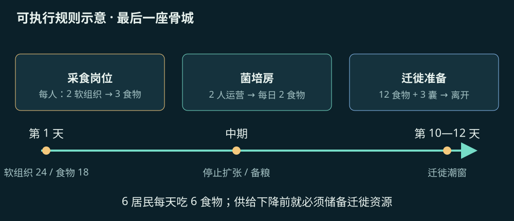

开局 6 居民、食物 18、软组织 24；每居民每天消耗食物 1。采食岗位每人每天将软组织 2 换食物 3；菌培房每日至多产食物 2，需要 2 人运营。第 10 天开启迁徙窗，必须提前积累 12 食物和 3 个迁徙囊。数值只用于首轮原型。

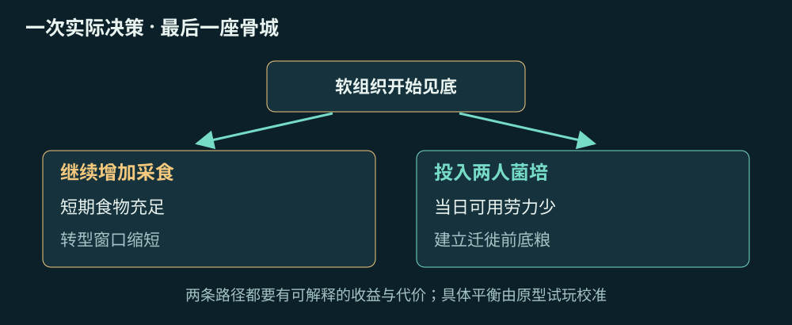

### 6. 核心循环与拼接

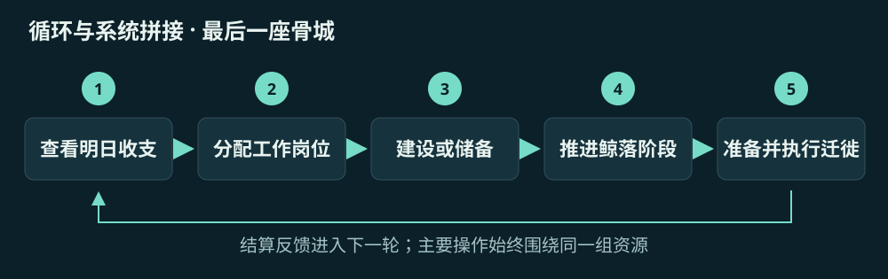

聚落岗位管理为主，鲸落生态阶段为外部时钟。可复用 01 的视觉演替，但不能同时做 01 的精细群落模拟；仅保留聚落赖以生存的两条供给链。

### 7. 开发范围与验证

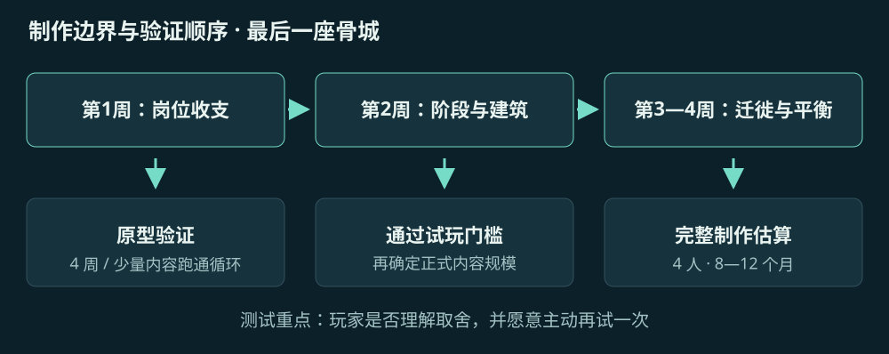

**最小可玩原型：** 1 个 12 日剧本、6 建筑、4 岗位、2 供给链、迁徙结算；用静态小组图标完成全过程。

**正式版上限：** 3 剧本、8 建筑、12 事件、两种迁徙策略；正式内容以经营转型为中心。

**删减：** 删除个体情绪、自由寻路、战斗、外交、遗传和开放世界。建筑只能落在固定槽，人口按小组结算。

**风险：** 最大风险是变成预算不够的大型殖民模拟。若四周内还无法让“扩张→转型→离开”跑通，应退回 03 的叠卡表达。

**验证门槛：** 8 位玩家中至少 6 位能在首次失败后明确说出转型过晚的原因；第二局至少 5 位主动提前储备，且不会全程采用唯一固定排班。

### 8. 原作参考

[The Wandering Village 官方商店](https://store.steampowered.com/app/1121640/)

借鉴 The Wandering Village 在巨型生物尺度上建设聚落的空间感与依存关系；改为静止遗骸、有限供给和主动迁徙。

原作是在活体巨兽背上生活；本案明确是鲸落，不设计控制鲸移动或饲养死鲸的机制。

图片版权归原作者。核对日期 2026-10-21。

## 选型、预算口径与主题边界

优先原型：03 一鲸万生、02 骨海拼图、09 深渊标本室。工期假设为有对应经验的全职团队、PC 单机、固定内容上限，含约20%调整测试余量，不含主机移植、全配音或持续运营。

可控拼接：03叠卡+09少量鉴定；04潜航+10货舱收纳；02拼板+01结算生态反馈。共享对象、资源或目标，避免两套独立经济。

主题依据：[NOAA](https://oceanservice.noaa.gov/facts/whale-fall.html)、[MBARI](https://www.mbari.org/news/fleshing-out-the-life-histories-of-dead-whales/)。资源、回合、发光与拟人设定为游戏抽象。

AI图来自内置imagegen，提示词在image-prompts.json；分镜并非实际成品截图，准确格位、规则与数值以示意图和正文为准。参考截图联网引用，版权归原作者。
